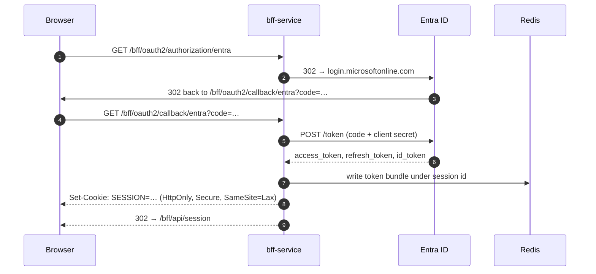
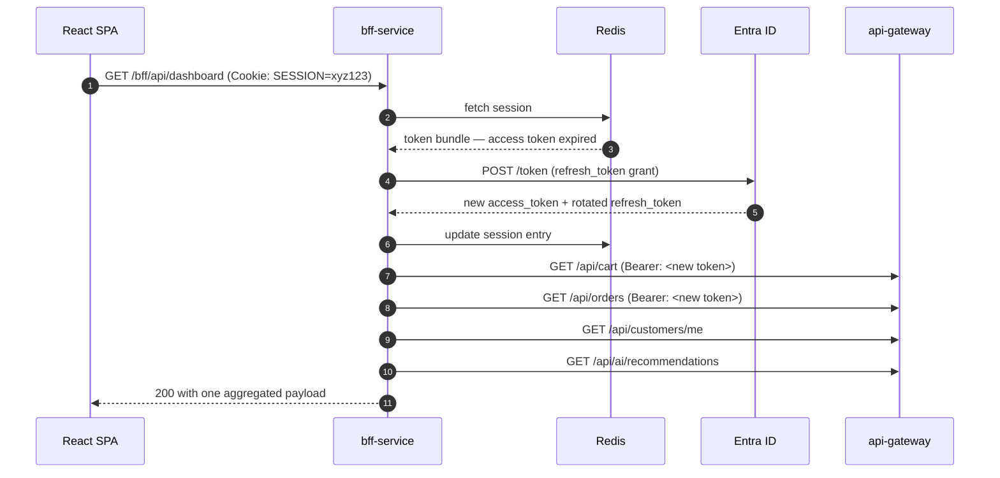

# BFF Layer: Browser Sessions and Silent Token Refresh

The `bff-service` module is the browser-facing half of the mesh. It exists so that
the storefront SPA never handles an OAuth2 token, and so that a compromised browser
cannot turn a stolen session into a long-lived credential.

This document describes the two flows and, where a decision was not obvious, why it
went the way it did.

---

## Where it sits

```text
                 ┌──────────────────────────┐
   Browser ──────│  bff-service  (Tomcat)   │──────► api-gateway ──► services
   (SPA)          │  /bff/api/**             │        (bearer token)   (mesh mTLS)
   cookie only    └───────┬──────────────────┘
                          │
                    ┌─────▼──────┐   ┌───────────────────────┐
                    │   Redis    │   │  Microsoft Entra ID   │
                    │  session   │   │  authorization_code   │
                    └────────────┘   └───────────────────────┘
```

The BFF is **in front of** the `api-gateway`, not behind it. The gateway stays the
single mesh entry point for every other client (mobile, partner APIs); the BFF is
just another in-mesh caller of it. That is why there is no direct client for any
business service in the codebase — routing everything through the gateway keeps
rate limiting, tenant re-derivation and per-route circuit breaking in exactly one
place. A BFF that called services directly would quietly become a second edge, and
would be the one path into the mesh that none of those controls applied to.

The `X-Tenant-ID` header the BFF sends downstream is **not** load-bearing for
security. `TenantForwardingFilter` in the gateway deletes any inbound value and
re-derives it from the validated access token, so a wrong or missing header here
cannot make the BFF impersonate another tenant. It is sent so the hop is readable
in a trace.

---

## Flow 1 — Sign-in



Five things are load-bearing here.

**The browser gets an opaque cookie, not a token.** `SESSION` is a session id and
nothing else. A stolen cookie is worth one idle-timeout window; a stolen access
token is worth its whole lifetime regardless of anything the server does.

**`offline_access` is a hard requirement, and a missing refresh token fails by
name.** If the scope is omitted, Entra never issues a refresh token, and the session
dies an hour later looking like a random logout. `SessionTokenService` therefore
treats "the provider never issued a refresh token" as its own distinct failure with
its own message, rather than letting it surface as an unexplained expiry.

**The token bundle is an `OAuth2AuthorizedClient`, not a bespoke record.** Spring
Session persists session attributes with JDK serialization, so the class name is
part of the stored format. A framework-owned type moves when the framework moves.

**`SameSite=Lax`, not `Strict`.** The OAuth2 callback arrives as a top-level
redirect from Entra. `Strict` would withhold the session cookie from it and sign-in
would not work at all.

**Session fixation switches the session id on privilege change** — the one moment an
attacker could otherwise have pre-chosen it.

---

## Flow 2 — Silent refresh



### Refresh 90 seconds early, not on expiry

`mesh.bff.refresh-skew` defaults to `90s`. Refreshing only once a token has already
expired means every request in that window becomes a 401 from the gateway, and a
clock boundary becomes a visible outage. Refreshing a little early trades one extra
token-endpoint call for never losing a request.

The skew is applied twice on purpose — once in `SessionTokenService.needsRefresh`
and again via `RefreshTokenOAuth2AuthorizedClientProvider.setClockSkew`. The
provider decides independently whether a token has expired; if its threshold were
lower than ours, `resolve()` would ask for a refresh, be handed the *unchanged*
client back, save it, and report a successful refresh that never happened while the
gateway went on rejecting the token. Setting both from the same property makes them
agree exactly.

### The concurrency question

Entra rotates refresh tokens: spending one invalidates it. Two concurrent requests
from one browser that both find an expired token would race, and the loser would
normally see `invalid_grant` and fail the shopper.

`resolve()` holds a **striped lock keyed on the session id** across load → refresh →
save. Tomcat hands the same `HttpSession` instance to every concurrent request for
it, so within a pod the second request blocks, re-reads the session after the first
has written, and finds tokens that no longer need refreshing.

Stripes rather than a map of per-session locks: a map would retain an entry for
every session the pod has ever seen, which is a slow leak on a service whose whole
job is handling logins.

Across replicas the session objects are distinct and the stripe does not help. That
gap is closed by the reload inside `refresh()`: the replica that loses the race sees
`invalid_grant`, re-reads the session, finds the winner's tokens and uses them —
reporting `refreshed=false` and **not** re-saving, because two writers to one
session is the thing to avoid. The aggregation endpoints reduce how often this
happens in the first place, because one shopper action is one BFF request.

A Redis lock (`SET NX PX`) around the refresh is the upgrade if this ever needs to
be airtight across replicas.

---

## Aggregations, and why failure is partial

`GET /bff/api/dashboard` fans out to four services concurrently on virtual threads
and folds the answers into one payload.

```json
{
  "profile": { "displayName": "Sam" },
  "cart": { "itemCount": 2, "subtotal": 20.00 },
  "recentOrders": [ { "id": "o1", "status": "PAID" } ],
  "recommendations": [],
  "sections": [
    { "section": "customer",       "available": true },
    { "section": "cart",           "available": true },
    { "section": "orders",         "available": true },
    { "section": "recommendations","available": false,
      "detail": "The service is temporarily unavailable" }
  ],
  "partial": true
}
```

The endpoint returns **200 even when a section failed**, and says which one in
`sections`. If recommendations are down the shopper still sees their cart; a 502
would throw away the three services that did answer. The `sections` array is also
what tells a human at 3am that a dashboard is subtly wrong.

The budget is **per request, not per call** (`mesh.bff.aggregation-timeout`,
default 5s, strictly under the 8s per-call read timeout). Without that, four calls
each allowed the full timeout would let a page take four times as long to *fail* as
to succeed, which is backwards.

Only `DownstreamException` messages reach the browser, and those are written by this
service for that purpose. Anything else — a `NullPointerException`, a serialisation
bug — becomes a generic message, so an internal class name and stack context never
land in devtools.

`GET /bff/api/public/storefront` deliberately makes **one** call. The category
breakdown is derived from the product page it already fetched. A shopper sees this
before signing in and is not paying for a fan-out they cannot see the value of.

---

## Security posture

Cookie-authenticated services are the structural inverse of every other service in
this mesh, and each inversion is a requirement rather than a preference:

| | Other mesh services | BFF |
|---|---|---|
| Credential | Bearer token | Session cookie |
| Session policy | `STATELESS` | `IF_REQUIRED` |
| CSRF | Disabled | **Enabled** |
| Unauthenticated response | `WWW-Authenticate: Bearer` | `loginUrl` in the body |

CSRF stays **on** because a cookie is attached by the browser with no cooperation
from the SPA, so an unauthenticated cross-site form could otherwise drive an
authenticated checkout. The gateway can disable CSRF precisely because its bearer
token is never attached automatically; this service cannot.

The SPA CSRF scheme uses a `CookieCsrfTokenRepository` with `httpOnly=false`, so the
token can be read and echoed in `X-XSRF-TOKEN`. The token is not a secret — its job
is to prove the request came from a page that could already read the cookie, which
is meaningless if JavaScript cannot read it. The **session** cookie stays
`HttpOnly`. `SpaCsrfTokenRequestAttributeHandler` accepts the raw cookie value in
the header while keeping the XOR masking for anything server-rendered, and
`CsrfCookieWritingFilter` forces the deferred token to materialise so the cookie is
actually written on the first request.

The 403 body distinguishes the two CSRF mistakes, because the fixes differ:

| Situation | Status | `csrfMissing` | What to tell the user |
|---|---|---|---|
| Correct token | `204` | — | — |
| Cookie present, header wrong/stale | `403` | `false` | re-read the cookie, resend |
| Cookie present, header absent | `403` | `true` | send the header |

`csrfMissing` is derived by reading the request header rather than from Spring's
exception. Spring reports "missing" only when there is no token to compare against
at all — no cookie — so an SPA holding a valid cookie but forgetting the header
would be told its cookie was invalid, and would go off to re-read something that
was never wrong.

The authorization rules end in `denyAll`, not `authenticated`. The BFF's API surface
is small and deliberate; anything that grows a mapping by accident fails closed
instead of quietly becoming part of the public contract.

### `common-security`'s tenant filter is switched off

`MeshSecurityAutoConfiguration` contributes a `TenantContextFilter`, and that filter
is an ordinary `Filter` **bean** — so Spring Boot registers it with the servlet
container automatically, whether or not it is in the Spring Security chain.
Declaring this service's own `SecurityFilterChain` does **not** switch it off.

It does not belong here. It resolves the tenant from a JWT claim into a
`ThreadLocal` that business services read, and this service reads no `TenantContext`
at all. With no claim to read it falls through to the caller-supplied
`X-Tenant-ID` **request header** — which on a browser edge is just whatever the
caller sent — and then echoes that back as a response header and into the log MDC.
Left enabled with the default `required: true`, it also rejected every anonymous
request with `400 Tenant Required`, taking the browsable storefront down entirely.

`BffSecurityConfig#disableTenantContextFilter` registers it as disabled, and
`BffApplicationContextTest` pins that, because a context-load test cannot see it and
the symptom appears only at runtime.

CORS uses **enumerated origins**, not patterns. The storefront is few and known, it
holds a SameSite-protected cookie, and `allowedOriginPatterns("*")` alongside
`allowCredentials(true)` would defeat SameSite — any site on the internet could
then make the shopper's browser ride its session. This overrides the shared
`common-security` CORS source by reusing its bean name.

---

## Configuration

Everything is overridable by environment variable; see `bff-service/src/main/resources/`.

| Variable | Default | Notes |
|---|---|---|
| `SERVER_PORT` | `8091` | |
| `MESH_GATEWAY_URI` | `http://api-gateway:8080` | The only route into the mesh |
| `SESSION_TIMEOUT` | `30m` | Idle timeout; also the blast radius of a stolen cookie |
| `SESSION_COOKIE_SECURE` | `true` | Must stay true behind TLS |
| `BFF_ALLOWED_ORIGINS` | `localhost:3000,localhost:5173` | Comma-separated, exact |
| `BFF_REFRESH_SKEW` | `90s` | Renew this early |
| `BFF_AGGREGATION_TIMEOUT` | `5s` | Whole-request budget |
| `BFF_READ_TIMEOUT` | `8s` | Per downstream call; must exceed the above |
| `BFF_REFRESH_ENABLED` | `true` | Off = session ends when the token expires |
| `ENTRA_CLIENT_ID`, `ENTRA_TENANT_ID` | — | Required by the `entra` profile |
| `ENTRA_CLIENT_SECRET` | *(empty)* | Public client needs none |
| `ENTRA_REDIRECT_URI` | `{baseUrl}/bff/oauth2/callback/{registrationId}` | Must match the app registration |

### Why the `entra` profile exists

The OAuth2 client registration lives in `application-entra.yml`, **not** in
`application.yml`.

```yaml
# This looks like it would leave the registration unconfigured...
client-id: ${ENTRA_CLIENT_ID:}
# ...but Boot validates any registration whose KEY exists:
# "Client id of registration 'entra' must not be empty."
```

An absent registration is skipped; a present-but-empty one is a startup crash. So
the registration is absent by default — which is what lets this service boot with no
Entra credentials at all (local dev, unit tests, and the anonymous storefront) —
and activated with `SPRING_PROFILES_ACTIVE=production,entra` wherever sign-in is
actually offered.

---

## API

| Method | Path | Auth | Purpose |
|---|---|---|---|
| `GET` | `/bff/api/public/storefront` | anonymous | Home page payload, one downstream call |
| `GET` | `/bff/api/session` | session | Who am I, token expiry, whether refreshable |
| `GET` | `/bff/api/dashboard` | session | Profile + cart + recent orders + recommendations |
| `GET` | `/bff/oauth2/authorization/{registrationId}` | anonymous | Start sign-in |
| `GET` | `/bff/oauth2/callback/{registrationId}` | anonymous | Entra redirect target |
| `POST` | `/bff/logout` | session + CSRF | Invalidate session, 204 |

`GET /bff/api/session` also acts as a refresh trigger: it routes through the same
`resolve()` as the aggregated endpoints, so a session whose access token has expired
gets a new one there rather than reporting an expiry that has already passed.

---

## Observability

`BusinessMetrics` counters under two domains:

- `mesh_business_events_total{domain="bff_session"}` — `token_reused`,
  `token_refreshed`, `refresh_raced_recovered`, `refresh_rejected`,
  `no_refresh_token`, `no_authorized_client`, `refresh_disabled`, `anonymous`
- `mesh_business_events_total{domain="bff_aggregation"}` — `<section>_ok` /
  `<section>_error` / `<section>_rejected`

Worth alerting on:

- `refresh_rejected` sustained — refresh tokens being rotated away under a race, or
  revoked in bulk at Entra
- `no_refresh_token` appearing at all — a scope list has lost `offline_access`, and
  every session will die an hour later
- `anonymous` spiking on `/bff/api/**` — the SPA is losing its cookie

Readiness deliberately **excludes Redis**. A shopper whose session cannot be read
can still browse the catalogue; failing readiness would pull every replica out of
the Service and turn a degraded session store into a total storefront outage.

---

## Known limits

- **Cross-replica refresh race.** Closed by the reload-and-reuse path, not by a
  distributed lock. Fine at this fan-out; see the upgrade note above.
- **Rate limits are sized for fan-out.** The BFF is charged against the same tenant
  bucket as any other client, so one dashboard call spends four requests' worth.
  That is the correct accounting, but the gateway's limits have to be set knowing it.
- **JDK serialization for session attributes.** The token bundle's class name is
  part of the stored format. Keeping it a framework type contains the blast radius
  to a Spring Security upgrade; a bespoke record would not.

---

## Verified behaviour

Exercised against the packaged jar, with no Redis and no identity provider, which is
the degraded configuration a local run produces:

| Check | Result |
|---|---|
| Boots with no Entra credentials | Logs a warning; the `entra` profile is simply absent |
| `GET /bff/api/dashboard`, no session | `401` `application/problem+json` carrying `loginUrl` |
| `GET /bff/api/public/storefront`, gateway down | `200` with `sections[0].available = false` |
| `GET /bff/api/public/storefront` | Sets `XSRF-TOKEN=…` with **no** `HttpOnly` |
| `POST /bff/logout`, valid cookie + header | `204` |
| `POST /bff/logout`, wrong header | `403`, `csrfMissing: false` |
| `POST /bff/logout`, header absent | `403`, `csrfMissing: true` |
| `GET /api/products` (not a BFF route) | `401`, i.e. `denyAll` held |