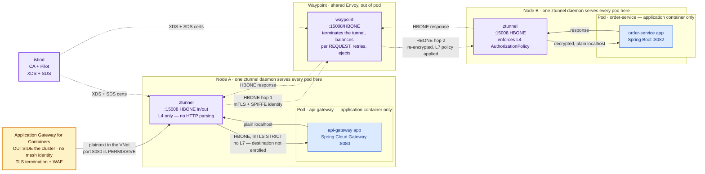
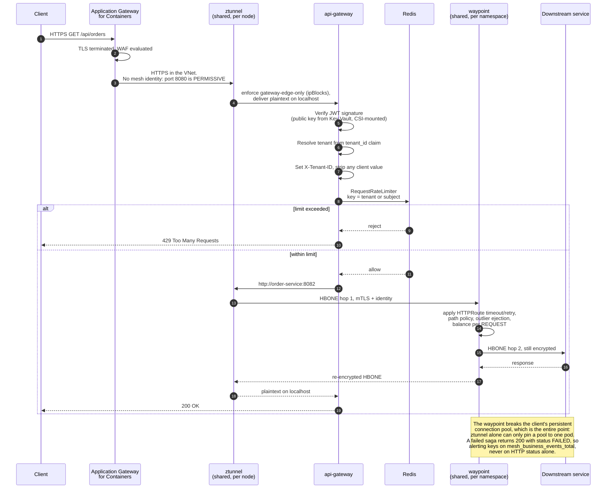
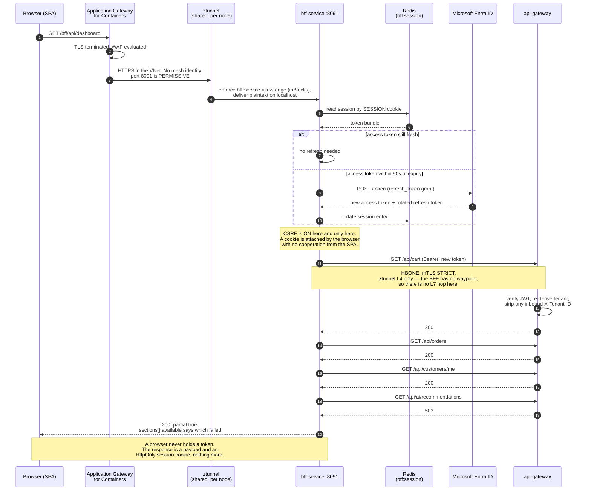
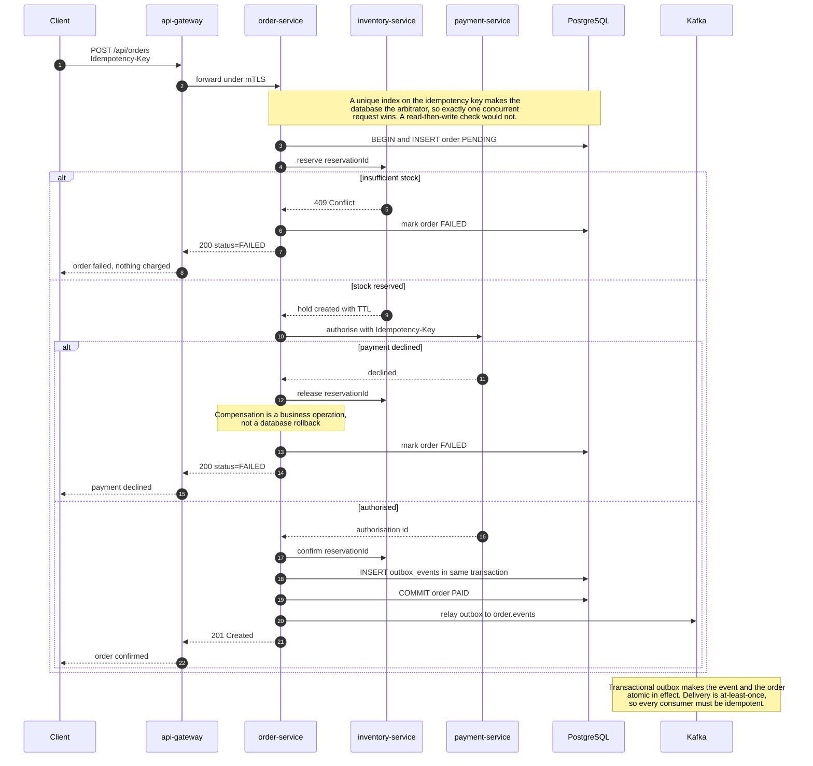
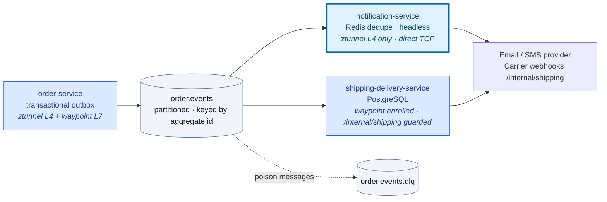

# High Level Design — Mesh Component Diagram

Companion to [SYSTEM_DESIGN_HLD.md](../SYSTEM_DESIGN_HLD.md), which records *why*
each decision was made. This document draws *what the deployed system looks like*.

Every component, port and policy below is taken from the code and manifests in
this repository, not from an idealised target state.

Editable diagram: [`docs/diagrams/hld-mesh-architecture.drawio`](diagrams/hld-mesh-architecture.drawio)
— page 1 is the production topology; page 2 is the observability deep dive.
The diagram is the visual summary; this file remains the written source of record.

---

## 1. System context

Istio runs in **ambient mode**. There is no per-pod proxy: a single `ztunnel`
daemon per node provides Layer 4 to every pod on it, and a shared `waypoint`
provides Layer 7 to the services that are enrolled. Every workload in the
namespace is inside the mesh — that is the point of ambient, and it is why the
two async Kafka consumers are no longer drawn outside the boundary.

```mermaid
flowchart TB
    Client["Client<br/>Web browser / mobile app"]
    AppGw["Azure Application Gateway for Containers<br/>GatewayClass azure-alb-external · AZURE MANAGED · ALB Controller configures it<br/>L7 routing (bypasses kube-proxy) · load balancing · WAF · per-client-IP rate limiting · TLS termination<br/><i>data plane runs OUTSIDE the cluster · no SPIFFE identity · cannot speak HBONE</i>"]
    Entra["Microsoft Entra ID<br/>OAuth2 authorization_code + refresh_token<br/><i>called by bff-service over public egress</i>"]

    subgraph k8s["AKS cluster · namespace: ecommerce · 12 services · 1 container per pod"]
        subgraph nodeproxy["PER-NODE DATA PLANE — one ztunnel daemon per node · Rust · L4 mTLS via HBONE"]
            Zt["ztunnel<br/>intercepts via istio-cni at the pod veth<br/>mTLS STRICT · identity · L4 authz"]
        end

        Istiod["istiod · Istio control plane<br/>CA · Pilot · owns ztunnel + waypoint deployments<br/><i>never on the request path</i>"]
        Waypoint["<b>waypoint</b> :15008/HBONE · shared Envoy · 2 replicas · PDB minAvailable 1<br/>per-REQUEST load balancing · retries · outlier ejection · path authz"]

        subgraph mesh["ISTIO MESH SCOPE — every pod below = application container only, no proxy"]
            subgraph edge["EDGE — entered by AGC, so BOTH serving ports are the PERMISSIVE exception"]
                BFF["<b>bff-service</b> :8091<br/>session cookie → bearer token · request aggregation · CSRF on<br/><i>own ServiceAccount sa/…-bff-service · no waypoint</i>"]
                GW["<b>api-gateway</b> :8080<br/>JWT · tenant · rate limit · circuit breaker<br/><i>port 8080 is PERMISSIVE: AGC has no mesh identity</i>"]
            end

            subgraph l4only["L4 only — ztunnel, no waypoint"]
                Notif["notification-service<br/>headless · :8081 actuator only · Kafka consumer · no HTTP business surface"]
            end

            subgraph l7["WAYPOINT-ENROLLED — ztunnel → waypoint → backend · 9 services"]
                subgraph edgeTier["Edge tier"]
                    Catalog["product-catalog-service :8085<br/>MongoDB + Redis cache"]
                    Review["review-rating-service :8088<br/>MongoDB"]
                    Cart["shopping-cart-service :8086<br/>Redis"]
                    Customer["customer-service :8087<br/>PostgreSQL"]
                    AI["ai-orchestrator-service :8090<br/>MongoDB"]
                end

                subgraph coreTier["Core tier · checkout path"]
                    Order["order-service :8082<br/>PostgreSQL · checkout saga"]
                    Inventory["inventory-service :8083<br/>PostgreSQL · optimistic locking"]
                    Payment["payment-service :8084<br/>PostgreSQL · provider tokenisation"]
                end

                Ship["shipping-delivery-service :8089<br/>PostgreSQL · Kafka consumer + /internal/shipping"]
            end
        end
    end

    subgraph managed["MANAGED AZURE SERVICES — state leaves the cluster"]
        PG[("PostgreSQL<br/>order · payment · inventory · customer · shipping")]
        RD[("Redis · Azure Managed<br/>cart · catalogue cache · BFF sessions · gateway rate limits")]
        Kafka[["Kafka event bus<br/>order.events · shipping.events · review.events · audit.trail<br/>order.notifications reserved · per-topic .dlq"]]
        MDB[("MongoDB<br/>catalogue · reviews · AI")]
        KV["Azure Key Vault<br/>CSI-mounted secrets · never env vars<br/><i>edge TLS cert synced to a Secret</i>"]
    end

    subgraph platform["Observability · namespace: observability"]
        Prom["Prometheus + Grafana<br/>mesh_business_events_total"]
        OTel["OTel Collector → Application Insights<br/>OTLP traces · 10% edge / 5% AI sampling"]
        Logs["Log Analytics · ECS structured logs"]
        ACR["Azure Container Registry · Jib images"]
    end

    Client -->|"HTTPS · TLS 1.3 terminated at AGC"| AppGw
    AppGw -.->|"PLAINTEXT over the VNet · no mesh identity, cannot speak HBONE<br/>authorized by source ADDRESS (ipBlocks), not by principal"| Zt
    Zt -.->|"PERMISSIVE 8091 · ipBlocks"| BFF
    Zt -.->|"PERMISSIVE 8080 · ipBlocks"| GW

    BFF -->|"HBONE · mTLS STRICT · bearer token"| Zt
    BFF -.->|"public egress · POST /token"| Entra
    BFF -.->|"session store"| RD

    GW -->|"HBONE · mTLS STRICT"| Zt
    Zt -->|"HBONE · enrolled destinations go via waypoint"| Waypoint
    Zt -->|"HBONE · direct, no waypoint"| Notif

    Waypoint --> Order
    Waypoint --> Inventory
    Waypoint --> Payment
    Waypoint --> Catalog
    Waypoint --> Review
    Waypoint --> Cart
    Waypoint --> Customer
    Waypoint --> AI
    Waypoint --> Ship

    GW -.->|"tenant-keyed rate-limit tokens"| RD
    Catalog -.->|"read-through cache"| RD

    Order -->|"reserve · confirm · release"| Inventory
    Order -->|"authorise · capture · refund"| Payment
    Order -->|"transactional outbox"| Kafka
    Kafka --> Notif
    Kafka --> Ship

    %% Per-service store ownership is carried by the node captions above and by
    %% the data-ownership table. Drawing eight more edges across the diagram
    %% added no information and buried the traffic path this diagram exists to
    %% show.
    edgeTier -.-> MDB
    coreTier -.-> PG

    Istiod -.->|"XDS + certs. Owns their lifecycle"| Zt
    Istiod -.->|"Owns this Deployment"| Waypoint
    Zt -.->|"L4 metrics · TCP telemetry"| platform
    Waypoint -.->|"HTTP metrics · access logs · spans"| platform
    mesh -.->|"OTel traces"| OTel

    classDef edge fill:#fef3c7,stroke:#d97706,stroke-width:2px,color:#451a03
    classDef svc fill:#dbeafe,stroke:#2563eb,color:#1e3a8a
    classDef l4 fill:#e0f2fe,stroke:#0369a1,stroke-width:2px,color:#0c4a6e
    classDef istio fill:#ede9fe,stroke:#7c3aed,stroke-width:2px,color:#2e1065
    classDef plat fill:#fce7f3,stroke:#be185d,color:#500724
    classDef data fill:#f1f5f9,stroke:#64748b,stroke-width:2px,color:#0f172a

    class AppGw,Entra,BFF,GW edge
    class Catalog,Review,Cart,Customer,AI,Order,Inventory,Payment,Ship svc
    class Notif l4
    class Istiod,Zt,Waypoint istio
    class Prom,OTel,Logs,ACR plat
    class PG,RD,Kafka,MDB,KV data
```



### How to read the Istio boundary

| Visual cue | Meaning |
|---|---|
| Inside **ISTIO MESH SCOPE** | Pod runs **only** the application container. `ztunnel` covers it at L4 whether or not it is drawn in a waypoint tier. Nothing is injected, so nothing restarts when the mesh is upgraded. |
| Inside **WAYPOINT-ENROLLED** | Additionally routed `ztunnel → waypoint → backend`, so it gets request-level load balancing, retries, outlier ejection and path-level authorization. **Nine of the twelve services**: everything except `api-gateway`, `bff-service` and `notification-service`. |
| Inside **EDGE** | Entered by Application Gateway for Containers, which has no mesh identity, so the serving port is the `PERMISSIVE` carve-out. Two workloads, not one: `api-gateway` :8080 and `bff-service` :8091. Neither has a waypoint, so each one's **ztunnel** is its enforcement point. |
| Inside **L4 only** | mTLS, workload identity and L4 authorization, but no HTTP processing. Correct for a Kafka consumer with no HTTP surface, and for the two edge workloads. |
| `Zt` / `Waypoint` (purple) | Shared data plane. `ztunnel` is a node DaemonSet; the waypoint is one Deployment for the whole namespace. Neither sits in an application pod. **Every L7 control in this design executes at the waypoint** — the retry budget, the timeouts, outlier ejection, per-request load balancing, and the `/api/*` + `/internal/*` path rules. A waypoint outage is handled at L4 by the `<svc>-require-waypoint` policies, which refuse to silently downgrade. |
| `Istiod` (purple) | Control plane. Owns the ztunnel and waypoint deployments; never on the request path. |
| `AppGw` (amber, outside the cluster boundary) | Application Gateway for Containers. Terminates public TLS and applies WAF. Replaces `ingress-nginx`, which reached end of life in March 2026. |

### The two holes in the mesh, stated plainly

Application Gateway for Containers runs its data plane **outside** the cluster.
It has no SPIFFE identity, does not speak HBONE, and cannot be given either, so
the mesh cannot authenticate it. Its built-in Istio integration would have
handled that automatically, but it assumes sidecars and **does not support
ambient mode**.

Consequently the serving ports of the **two** edge workloads are the only
`PERMISSIVE` exceptions in an otherwise `STRICT` namespace:

```yaml
# PeerAuthentication/api-gateway-edge-port
selector:
  matchLabels:
    app.kubernetes.io/name: api-gateway
mtls: { mode: STRICT }
portLevelMtls:
  8080: { mode: PERMISSIVE }

# PeerAuthentication/bff-service-edge-port
selector:
  matchLabels:
    app.kubernetes.io/name: bff-service
mtls: { mode: STRICT }
portLevelMtls:
  8091: { mode: PERMISSIVE }
```

Everything east of the edge — the whole checkout path — remains `STRICT` and
still refuses plaintext. The AGC → edge hop is protected instead by source
address (`AuthorizationPolicy` `ipBlocks`, mirrored in a `NetworkPolicy`) plus
the WAF. That is addressing rather than identity, and it is the weakest point in
the design.

> **The BFF widened this surface rather than removing it.** Before it existed,
> there was one plaintext entry port. There are now two, and both are reachable
> from any pod that can spoof a source address inside the AGC subnet range. The
> `bff-service-edge-only` NetworkPolicy and the `bff-service-allow-edge`
> AuthorizationPolicy exist to stop a compromised in-cluster pod reaching it
> *directly*; neither protects the edge port itself from a source-address
> forgery, because the only attribute available for an identity-less peer is
> the address.

The fully authenticated alternative is an Istio ingress gateway
(`gatewayClassName: istio`) between AGC and the application, giving AGC a real
mesh peer to authenticate against at the cost of one more L7 hop. See
[AKS-DEPLOYMENT.md](AKS-DEPLOYMENT.md) §5.4.

### Why these nine are enrolled and these three are not

Enrollment is declared per destination Service as `waypoint: true` in
`deploy/helm/enterprise-ecommerce/values.yaml`, and rendered as the
`istio.io/use-waypoint` label plus a matching `<svc>-require-waypoint`
`AuthorizationPolicy`. The label and the policy must agree; the label alone
records intent that ztunnel will quietly ignore if the waypoint is missing.

| Service | Enrolled | Why |
|---|---|---|
| order, inventory, payment | yes | Checkout path. Retries and outlier ejection, and `POST` is never replayed |
| product-catalog, review-rating, shopping-cart, customer, ai-orchestrator | yes | Read-heavy or fanned out; need per-request balancing rather than a pinned connection pool |
| shipping-delivery | yes | Sits on the async tier but exposes `/internal/shipping` for carrier webhooks, and path-level authorization of that surface is an L7 rule |
| notification | **no** | Pure Kafka consumer, headless, :8081 actuator only. A waypoint would parse nothing |
| api-gateway, bff-service | **no** | Edge workloads. Entered from outside the mesh, and Istio models ingress-to-service separately from east-west traffic. Everything they *call* still traverses ztunnel for mTLS |

A selector-targeted rule would not work for the notification service: ztunnel
cannot evaluate a path, and fails safe by turning the whole policy into a deny.
See [Istio.md](Istio.md) §2.

### Data ownership

Each service owns its store outright. No service reads another's tables.

| Store | Services | Reason |
|---|---|---|
| PostgreSQL | order, payment, inventory, customer, shipping | Transactions, constraints, monetary precision (`NUMERIC(19,4)`) |
| MongoDB | catalogue, review, AI | Variable document shape, read-heavy |
| Redis | cart, catalogue cache, BFF sessions (`bff:session`), gateway rate limits | Ephemeral, low-latency |
| Kafka | event backbone, `.dlq` per failing topic | Ordered per aggregate, at-least-once |

> **Redis has two homes in configuration and the diagram picks the managed
> one.** `values-prod.yaml` points `infrastructure.redis.host` at
> `enterprise-cache.redis.cache.windows.net` (Azure Managed, outside the
> cluster), which is what is drawn above and what `allow-managed-data-egress`
> expects. The chart *default* in `values.yaml` still names an in-cluster
> address, `redis-cache.redis.svc.cluster.local`, and `bff-service.yaml` hardcodes
> that same in-cluster default. Reconcile the two before deploying anywhere but
> prod — see [§8](#8-documented-policy-vs-deployed-reality), divergence 7.

---

## 2. Pod anatomy — where Istio actually acts

This is the detail the top-level view cannot show. **No pod contains a proxy.**
The request crosses a `ztunnel` on the caller's node, the waypoint, and a
`ztunnel` on the callee's node — three shared processes rather than two per-pod
containers.



Consequences worth remembering:

- **The application never sees a certificate.** It speaks plain HTTP on
  localhost and `ztunnel` handles TLS to the network. There is no TLS config in
  any `application.yml` in this repo, by design.
- **The BFF is entered exactly the way the gateway is**, and has no waypoint of
  its own, so the same diagram applies with `:8091` and `sa/…-bff-service` in
  place of `:8080` and `sa/…-gateway-service`. Its one privileged path inward
  is the principal `cluster.local/ns/ecommerce/sa/…-bff-service`, which the
  namespace-wide `default-deny` would otherwise refuse.
- **The application pod contains one container.** Upgrading the mesh is a
  `ztunnel` DaemonSet rollout and, at most, a waypoint rollout. Not a single
  application pod restarts, and no container waits on a proxy being ready —
  which is the startup race the previous sidecar design had to work around.
- **`istiod` is off the data path.** If it is unavailable, ztunnel and the
  waypoint keep serving with their last-known config.
- **`ztunnel` is deliberately Layer 4 only.** A policy that *targets* a workload
  with a `selector` and contains a `paths` or `methods` match is not partially
  applied — ztunnel fails safe and turns it into a blanket `DENY`. Path rules
  must be *attached* to the waypoint with `targetRefs`.
- **NetworkPolicy has to know about port 15008.** Ambient terminates HBONE on
  15008 and only then forwards to the application port, and NetworkPolicy is
  evaluated on the host before the tunnel is unwrapped.

---

## 3. Istio control plane and enforcement map

Ambient enforces in two places. The distinction is not cosmetic: an L7 rule in
the wrong one either does nothing or denies everything.

| Istio resource | Enforced by | What it enforces |
|---|---|---|
| `PeerAuthentication/default` | ztunnel | mTLS **STRICT** namespace-wide. PERMISSIVE would silently allow plaintext, so a misconfigured workload quietly loses encryption. |
| `AuthorizationPolicy/default-deny` | ztunnel | `spec: {}` — deny all. Istio evaluates deny first, so `ALLOW` rules can only ever narrow further. |
| `AuthorizationPolicy/gateway-edge-only` | ztunnel | The gateway has no waypoint, so its ztunnel is the enforcement point. Application Gateway for Containers has no mesh identity, so it is authorized by source **address** (`ipBlocks`), not by principal. Also names `sa/…-bff-service` as the one in-mesh workload allowed to call the gateway. |
| `PeerAuthentication/api-gateway-edge-port` | ztunnel | A `PERMISSIVE` carve-out in a `STRICT` namespace, on the gateway's serving port only. Required because AGC cannot be authenticated. |
| `AuthorizationPolicy/bff-service-allow-edge` | ztunnel | Same reasoning for the BFF. No waypoint, so its ztunnel is the enforcement point: AGC by address, plus namespace callers. |
| `PeerAuthentication/bff-service-edge-port` | ztunnel | The second `PERMISSIVE` carve-out, on the BFF's serving port :8091. |
| `AuthorizationPolicy/<svc>-require-waypoint` | ztunnel | One per enrolled service — nine of them. Allowing **only** `sa/waypoint`. This is what stops a waypoint outage from silently downgrading the service to L4 with every L7 rule unenforced. |
| `AuthorizationPolicy/notification-service-allow-mesh` | ztunnel | Not enrolled and has no HTTP surface, so the caller's real identity is still visible at L4. |
| `AuthorizationPolicy/allow-observability` | ztunnel | Prometheus scrape and OTLP export from the `observability` namespace. |
| `AuthorizationPolicy/waypoint-surface` | **waypoint** | Attached via `targetRefs: Gateway`. Opens `/api/*`, `/internal/*` and the health/metrics endpoints; keeps `/actuator/*` admin to the control plane. |
| `AuthorizationPolicy/deny-internal-from-gateway` | **waypoint** | Explicit `DENY` on `/internal/*` for the gateway principal, so widening the public surface later cannot silently reopen the carrier webhook. |
| `Telemetry/mesh-access-logging` | istiod → ztunnel, waypoint | Envoy access logs for every hop. Also carries the `tracing` block when `istio.tracingProvider` names a provider that exists in istiod's `MeshConfig` — see `deploy/istiod/`. |
| `HTTPRoute/<svc>-resilience` | **waypoint** | 10s request budget, 3s per-try, 2 retries on `502/503/504` — **for idempotent verbs only**. See the note below. |
| `Gateway/waypoint` | istiod | Declares the shared L7 proxy. istiod owns the resulting Deployment, Service and ServiceAccount. |

### What a trace actually contains

Worth stating plainly, because "distributed tracing" in an HLD usually implies
more than this.

| Hop | Spans? | Why |
|---|---|---|
| AGC → gateway | **No** | Azure-managed load balancer outside the cluster. No `traceparent` is sent, so **the gateway's server span is the root** of every checkout trace |
| `api-gateway` → service | Yes | Micrometer. Spring Cloud Gateway observation |
| gateway → order → inventory / payment → provider | Yes | Micrometer on both sides; the auto-configured `RestClient.Builder` carries the W3C propagation |
| waypoint hop | Yes, **in prod only** | The `Telemetry` tracing block. Retries, timeouts, HBONE queueing and mTLS handshake time, none of which the application can measure |
| **ztunnel hop** | **No, ever** | ztunnel is L4. It does not parse HTTP and does not generate spans. Visible in access logs and TCP telemetry only. Not fixable by configuration |
| order → Kafka → notification / shipping | **No** | Delivery is Debezium streaming the PostgreSQL WAL, not a traced publish. `CloudEventHeaders` carries `ce_correlationid`; no `traceparent` crosses the boundary. A second, separate trace tree, correlatable only by correlation id |

Sampling is `0.1` for request paths and `0.05` for the AI tier. The root span
decides, so **most requests have no trace to find** — a trace id in an error body
resolves in Application Insights only when that request was sampled. The active trace id is
returned in every RFC 9457 problem body, which is how you get from "a customer
saw an error" to a trace at all.

Proxy and application sample independently, even at matched rates, so a few
traces will be rooted at the waypoint with no application parent. Expected, not
a fault.

> **The retry rule now matches what it always claimed to do.** The previous
> `VirtualService` carried a single rule matching `uri.prefix: /api/` with
> `retryOn: 5xx,...` and a comment saying only idempotent verbs were retried.
> `VirtualService` has no per-method retry gate, so that rule would in fact have
> retried `POST /api/payments` — replaying a charge. The `HTTPRoute` splits the
> rules by method: `GET`/`HEAD`/`OPTIONS` get the retry budget, everything else
> gets the timeout budget and is never replayed. `500` is also excluded on
> purpose, because it usually means the backend processed the request and failed
> afterwards.

> **Outlier ejection and load balancing are no longer hand-written.** They came
> from `DestinationRule/order-service` (`LEAST_REQUEST`, connection pool caps,
> ejection after 5 consecutive 5xx) and they applied only to the three checkout
> services. In ambient they are the waypoint's defaults and apply to every
> enrolled service. `VirtualService` and `DestinationRule` are Alpha with the
> ambient data plane and must not be mixed with Gateway API configuration.

---

## 4. Request path — authentication, tenancy, rate limiting

There are **two** edges, and which one you arrive at depends on the client.

- **Browser** → AGC → `bff-service` :8091 → `api-gateway` :8080 → services.
  The BFF holds the session cookie and never lets a token reach the browser. It
  exchanges that cookie for a short-lived bearer token and then behaves like any
  other API client of the mesh.
- **Mobile / partner** → AGC → `api-gateway` :8080 → services. The identity
  provider issues the JWT and the client holds it.

Everything past the gateway is a **stateless resource server**: the gateway only
validates the token and strips any client-supplied tenant header. Neither edge
bypasses the gateway — the BFF is just another in-mesh caller of it, which is
what keeps rate limiting, tenant re-derivation and per-route circuit breaking in
exactly one place.

> Earlier revisions of this document stated there was no BFF and no login page.
> That was true when it was written and is no longer. See [§8](#8-documented-policy-vs-deployed-reality),
> divergence 6.



**Why the tenant header is stripped at the gateway.** Without that step a caller
could send `X-Tenant-ID` directly and impersonate another tenant, because the
header alone would be trusted. Downstream services re-resolve from their own JWT —
defence in depth, since a compromised in-cluster pod could call a service
directly and bypass the gateway entirely.

The strip is load-bearing for the BFF too, and is the reason the BFF's forwarding
of `X-Tenant-ID` is cosmetic: a wrong or missing value on that hop cannot make the
BFF impersonate a tenant, because the gateway deletes it and re-derives it from the
validated access token either way. It is sent so the hop is readable in a trace.

### The browser path



The BFF aggregates four calls into one response and returns **200 even when a
section failed**, reporting which one in `sections[]`. A 502 would throw away the
three services that did answer. Its whole-request budget (5s) is deliberately
smaller than the per-call budget (8s), or a failing page would take four times as
long to fail as to succeed.

Note the consequence for the edge: once the BFF is in front, **every anonymous
storefront request arrives at the gateway from a BFF pod address**, so per-IP rate
limiting at the gateway would pool every shopper into one bucket. Per-client-IP
limiting is therefore a WAF responsibility at AGC, which still holds the true
address — the only layer that does.

---

## 5. Checkout saga — the money path

Spans three databases, so no distributed transaction is available. Every step is
idempotent because Kafka delivers at-least-once.



---

## 6. Event flow — and where the mesh stops

`order-service` publishes to a single topic and both consumers read it. Kafka
itself runs outside the mesh, so ztunnel passes these connections through as
plain TCP — which is correct: there is no in-mesh peer on the far side to
encrypt to, and no HTTP to parse.



> **Note.** `order.notifications` is declared in `MessagingTopics` and
> bootstrapped by the chart, but both async workers currently consume
> `order.events`. The topic is reserved for a future split of notification
> fan-out; nothing reads it today.

---

## 7. Network trust boundaries

Enforced with Kubernetes `NetworkPolicy`, independent of and beneath Istio, and
applying to **every** pod in the namespace.

| Policy | Effect |
|---|---|
| `default-deny-all` | Namespace-wide deny on ingress **and** egress, so an accidental new Service fails closed rather than open |
| `allow-health-probes` | Re-allows the link-local source addresses ambient uses for kubelet probes (`169.254.7.127/32`, and the IPv6 equivalent). Without this, a default-deny fails every readiness probe in the namespace the moment the pods join the mesh. |
| `gateway-edge-only` | The gateway's port 8080 is reachable **only** from Application Gateway for Containers' subnet (`ipBlocks`) — plus 15008, which is where ambient actually terminates the tunnel |
| `bff-service-edge-only` | The same rule for the BFF on :8091. Generated by the chart from the same `edgeExposed: true` flag as the gateway's, so the two cannot drift apart. |
| `allow-dns-egress` | Explicitly re-allows UDP/TCP 53 to kube-dns, which a default-deny would otherwise break and which every service needs to resolve service names |
| `allow-intra-namespace` | Lets mesh pods reach each other on any port, including 15008 |
| `waypoint-allow-ingress` / `allow-waypoint-egress` | Let traffic reach the waypoint's 15008. The waypoint pods are labelled `gateway.networking.k8s.io/gateway-name`, not `app.kubernetes.io/part-of`, so no other policy in the namespace selects them. |
| `waypoint-allow-egress` | Lets the waypoint reach the backends it balances across, plus DNS |
| `allow-managed-data-egress` | Opens egress to Azure Postgres and Redis, which live outside the cluster |

> **Egress containment is IP-based and has a hole.** `NetworkPolicy` cannot match
> a hostname, so every public endpoint — Microsoft Entra ID, Key Vault, Service
> Bus, Monitor — is outside what these rules can express. The BFF calls
> `login.microsoftonline.com` on every sign-in and every silent refresh, and the
> only rule permitting it is the broad DNS egress above. See [§8](#8-documented-policy-vs-deployed-reality),
> divergence 8.

Secrets are **mounted, never injected**: the Key Vault CSI driver writes them to
the filesystem, so they never appear in environment variables (visible via
`/proc` and crash dumps) or in etcd. The payment service stores only an opaque
single-use token — no PAN ever enters the mesh, which keeps PCI scope to the
provider's SDK.

---

## 8. Documented policy vs deployed reality

Worth resolving before this diagram is treated as authoritative.

| # | Divergence | Status |
|---|---|---|
| 1 | `Istio.md` excluded `notification-service` and `shipping-delivery-service` from sidecar injection, but the chart injected into every enabled service, so none of the three claimed savings was realised. | **Resolved, and the premise is gone.** Ambient injects nothing anywhere. Layer 7 is enrolled per Service from `waypoint: true` in values, so `notification-service` genuinely runs L4-only. The memory and startup-latency savings now apply to *all twelve* services rather than the handful the chart happened to skip. |
| 2 | `deny-external-to-internal` protected `shipping-delivery-service` `/internal/*`, but a pod with no sidecar has nothing to enforce it, and no `NetworkPolicy` opened that path. | **Resolved.** `shipping-delivery-service` is now enrolled in the waypoint — correctly, since it really does expose `/internal/shipping`. The path rule moved to `AuthorizationPolicy/deny-internal-from-gateway`, attached via `targetRefs` so the waypoint enforces it. |
| 3 | The kustomize base documented Istio opt-out while containing only namespace + gateway, so behaviour depended on the deployment path. | **Resolved.** `platform/kubernetes/istio` is now a real, applyable overlay (`kubectl apply -k platform/kubernetes/istio`) holding the waypoint and the policies, matching what the chart renders. Both paths declare the same architecture. |

Two divergences this migration *created*, recorded here so they are not
rediscovered as surprises:

| # | Divergence | Status |
|---|---|---|
| 4 | The old `AuthorizationPolicy/restrict-egress` (outbound allow-list) is gone. | **Deliberate, and it was already inert.** ztunnel enforces authorization on the *receiving* side of a connection, so a namespace-wide ALLOW policy listing destination hosts is an ingress policy that looks like an egress policy and provides no egress containment. Keeping it would have been decoration implying a control that was not there. Egress containment is `NetworkPolicy`'s job — `default-deny-all` plus `allow-managed-data-egress` — and it is IP-based. Hostname-level egress policy would need a waypoint deployed as an egress gateway, which this release does not do. |
| 5 | `shipping-delivery-service` is enrolled in the waypoint even though it sits on the async tier. | **Deliberate.** It exposes `/internal/shipping`, so it is not the pure-Kafka consumer the old matrix assumed. See [Istio.md](Istio.md) §2. |

Divergences the addition of `bff-service` created. Recorded here rather than
fixed silently, because each one is a decision someone should make deliberately:

| # | Divergence | Status |
|---|---|---|
| 6 | This document and `SYSTEM_DESIGN_HLD.md` both described a mesh with **no BFF and no login page**, and counted eleven services. | **Resolved in the docs.** `bff-service` exists, is deployed, has its own ServiceAccount, its own edge mTLS carve-out and its own `AuthorizationPolicy`. Both documents now say twelve and describe the two-edge path. The runtime was always correct — only the documentation was stale. |
| 7 | Redis is configured in two places with different topologies. `values-prod.yaml` names an Azure Managed host (`enterprise-cache.redis.cache.windows.net`); the chart default in `values.yaml` and the hardcoded value in `platform/kubernetes/base/bff-service.yaml` both name an in-cluster address (`redis-cache.redis.svc.cluster.local`). | **Open — needs a decision.** Worse, `allow-managed-data-egress` renders `infrastructure.redis.host` into a NetworkPolicy `ipBlock.cidr`, and **neither value is a CIDR**. The rule is invalid as written in both environments. Either the value becomes a separate `redis.cidr` alongside `redis.host`, or the policy moves to a Cilium/FQDN egress implementation. |
| 8 | `deny-internal-from-gateway` denies `/internal/*` only to `sa/…-gateway-service`. The BFF's principal is not denied, and `waypoint-surface` **ALLOWs** `/internal/*` to anyone who reaches the waypoint. | **Open — needs a decision.** The carrier webhook surface is therefore reachable from any mesh workload with a waypoint path, not just from the gateway. Either widen the DENY to every shopping principal, or narrow `waypoint-surface` to `/internal/*` for `shipping-delivery-service` alone via a `targetRefs` policy on that Service. |
| 9 | Egress to Microsoft Entra ID is unrestricted. `NetworkPolicy` matches no hostname, so `bff-service`'s `POST /token` to `login.microsoftonline.com` is permitted only by the broad DNS egress rule. | **Open, and structural.** It is the same class of gap as divergence 4 — IP-based egress containment cannot express it. Closing it properly means a waypoint deployed as an egress gateway, or FQDN policy from Cilium. Recorded rather than worked around. |

---

## What this diagram does not show

Honest gaps, carried over from the open questions in
[SYSTEM_DESIGN_HLD.md](../SYSTEM_DESIGN_HLD.md):

- **Multi-region.** Single region with zone redundancy. Active-active would need
  conflict resolution on the order and payment ledgers.
- **Partition ordering.** Per-aggregate ordering holds within one Kafka partition
  in one region only.
- **Recommendation model.** The shipped ranking is a transparent heuristic that
  can be explained and regression-tested, not a learned model.
- **Runtime verification.** This project has no integration tests, so the routing
  and policy behaviour above is asserted from configuration, not from an executed
  test suite. The BFF is the one partial exception: `BFF-SESSION.md` records
  behaviour exercised against the packaged jar.
- **Cross-replica session refresh.** Closed by a reload-and-reuse path rather
  than a distributed lock. Fine at the current fan-out; a `SET NX PX` lock around
  the refresh is the upgrade if it ever needs to be airtight.
- **GraphQL-style fan-out is not modelled.** The BFF aggregates, but there is no
  query planner, no batching and no N+1 protection beyond the whole-request
  budget.
- **The draw.io diagram is a presentation view, not a second source of truth.**
  `docs/diagrams/hld-mesh-architecture.drawio` renders §1 and the deployment
  manifests as native draw.io cells. **This markdown is the source of record.**
  Do not hand-edit the diagram to introduce facts that are not recorded here.