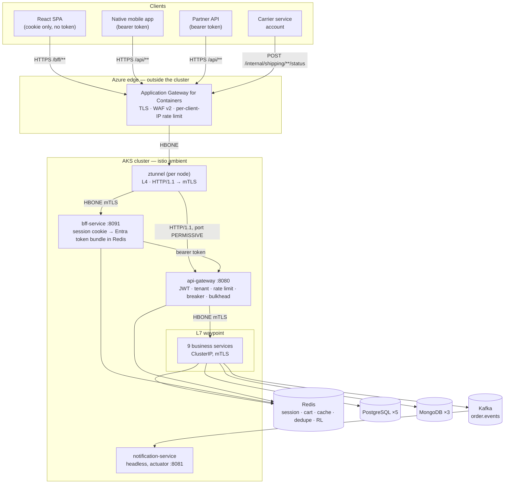
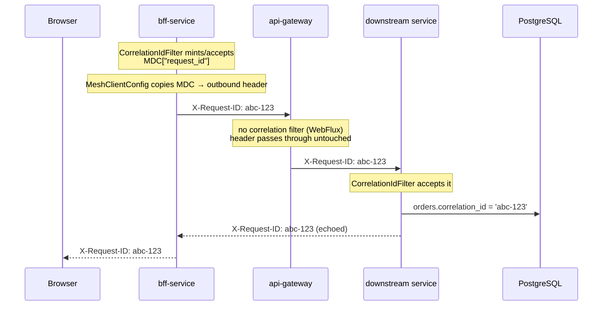
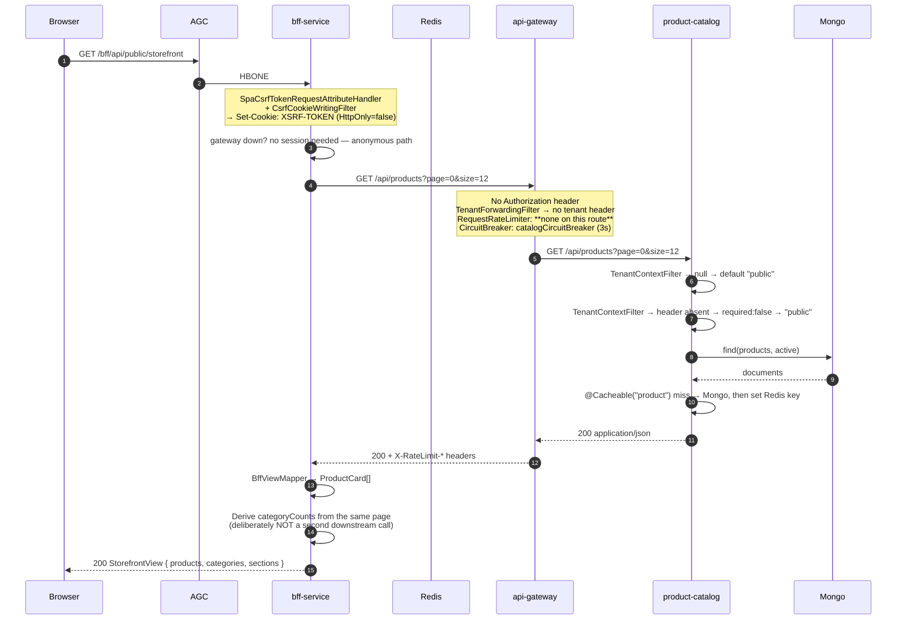
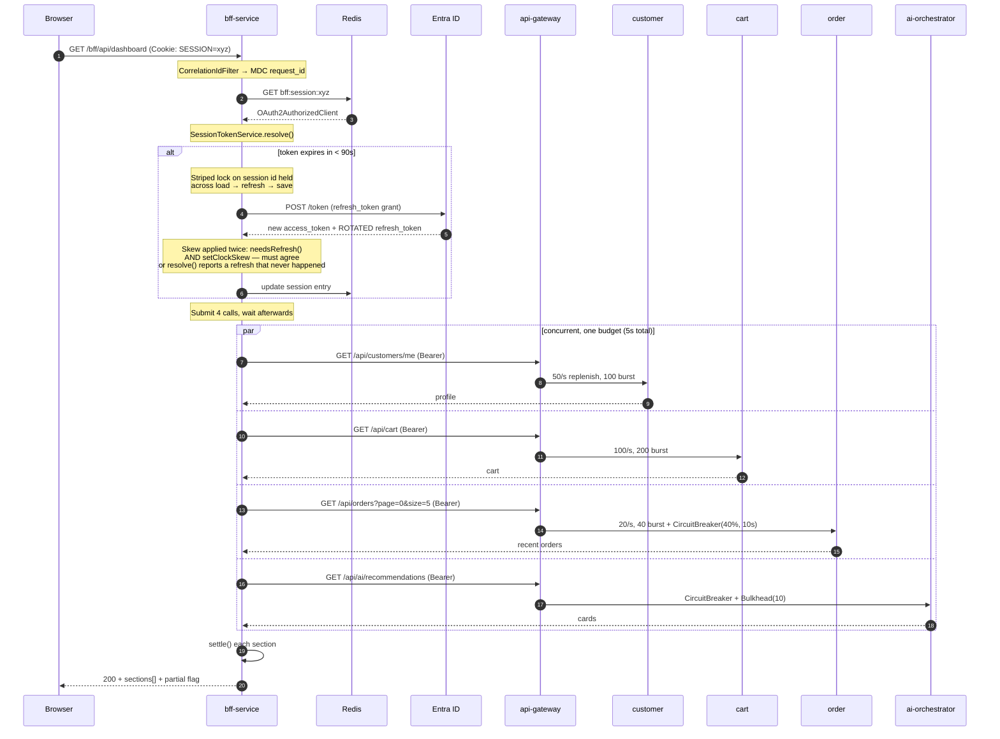
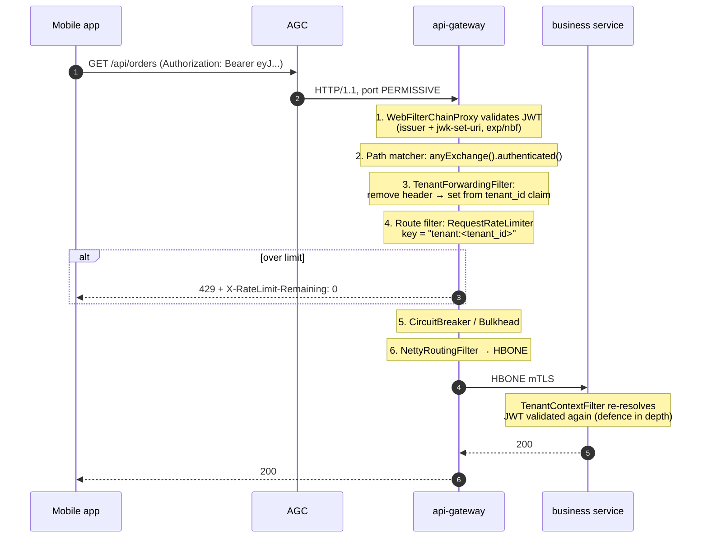
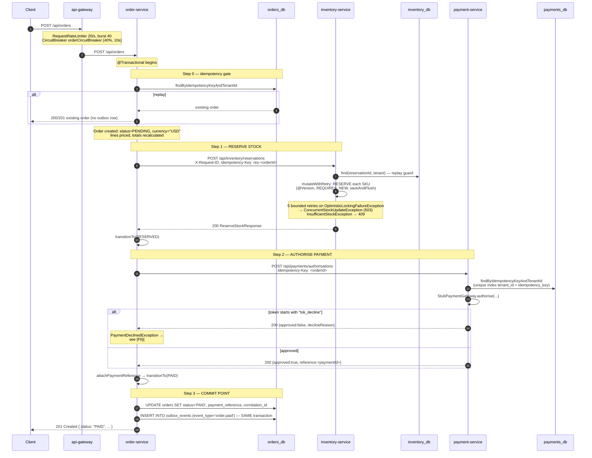
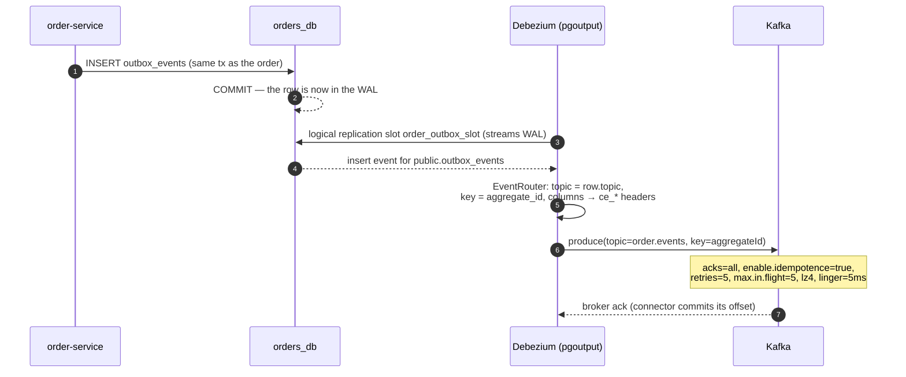
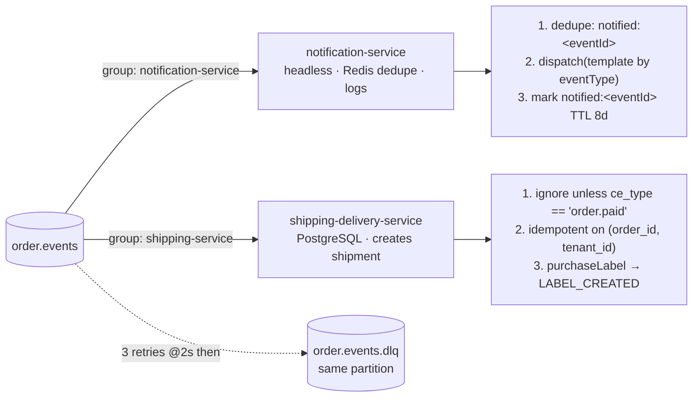
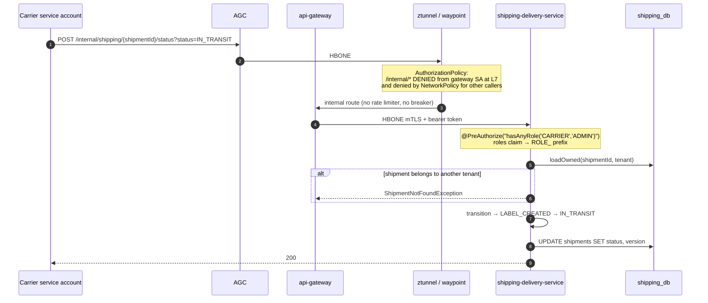

# End-to-End Request Flow

**Enterprise Multi-Tenant E-Commerce Mesh** — a trace of every request from the socket to the database and back, covering eight distinct flows across twelve services.

This document is derived from the code, not from the diagrams. Where the implementation and
`docs/ARCHITECTURE.md` / `docs/E2E_BUSINESS_ARCHITECTURE_GUIDE.md` disagree, **the code wins** and the
divergence is recorded in [§15 Verified Observations](#15-verified-observations-doc-vs-code).

Related documents: [ARCHITECTURE.md](ARCHITECTURE.md) (design intent) · [BFF-SESSION.md](BFF-SESSION.md)
(BFF session model) · [Istio.md](Istio.md) · [RUNBOOK.md](RUNBOOK.md) ·
[hld-mesh-architecture.drawio](diagrams/hld-mesh-architecture.drawio) (HLD reference diagram)

---

## Table of contents

1. [Topology at a glance](#1-topology-at-a-glance)
2. [Component reference](#2-component-reference)
3. [The layers every request crosses](#3-the-layers-every-request-crosses)
4. [F0 — Edge ingress](#f0--edge-ingress)
5. [F1 — Anonymous storefront read](#f1--anonymous-storefront-read)
6. [F2 — Sign-in (OAuth2 authorization code)](#f2--sign-in-oauth2-authorization-code)
7. [F3 — Authenticated browser request + silent refresh](#f3--authenticated-browser-request--silent-refresh)
8. [F4 — Native / partner client direct to gateway](#f4--native--partner-client-direct-to-gateway)
9. [F5 — Checkout saga, happy path](#f5--checkout-saga-happy-path)
10. [F6 — Checkout saga, payment declined (compensation)](#f6--checkout-saga-payment-declined-compensation)
11. [F7 — Outbox → Kafka → async consumers](#f7--outbox--kafka--async-consumers)
12. [F8 — Carrier webhook → shipment status](#f8--carrier-webhook--shipment-status)
13. [Cross-cutting contracts](#13-cross-cutting-contracts)
14. [Data ownership](#14-data-ownership)
15. [Verified observations (doc vs code)](#15-verified-observations-doc-vs-code)

---

## 1. Topology at a glance



**Only `api-gateway` and `bff-service` are reachable from outside the cluster.** Every other service is
ClusterIP behind Istio authorization policies, reachable only from the shared L7 waypoint or the
gateway's service account.

### The one structural fact worth memorising

`order-service` reaches `inventory-service` and `payment-service` by **plain service DNS, not through the
gateway**. Those two calls originate inside the saga orchestrator and are the only intra-platform
HTTP calls that bypass the edge. That is intentional — they are service-to-service, authenticated by
mesh mTLS plus a `ROLE_SERVICE` bearer token, and they carry their own `X-Tenant-ID` and
`X-Request-ID` headers.

Everything a *client* initiates goes through `api-gateway`.

---

## 2. Component reference

| Component | Port | Tier | Data store | Reachable from |
|---|---|---|---|---|
| `bff-service` | 8091 | edge | Redis (session) | AGC only |
| `api-gateway` | 8080 | edge | Redis (token bucket) | AGC, BFF SA |
| `product-catalog-service` | 8085 | edge-facing | Mongo `catalog_db` + Redis cache | waypoint |
| `review-rating-service` | 8088 | edge-facing | Mongo `reviews_db` | waypoint |
| `ai-orchestrator-service` | 8090 | edge-facing | Mongo `ai_db` + Redis | waypoint |
| `shopping-cart-service` | 8086 | core | Redis only | waypoint |
| `customer-service` | 8087 | core | PostgreSQL `customers_db` | waypoint |
| `order-service` | 8082 | core | PostgreSQL `orders_db` | waypoint |
| `inventory-service` | 8083 | core | PostgreSQL `inventory_db` | waypoint, **order-service direct** |
| `payment-service` | 8084 | core | PostgreSQL `payments_db` | waypoint, **order-service direct** |
| `shipping-delivery-service` | 8089 | async | PostgreSQL `shipping_db` | waypoint |
| `notification-service` | none (`-1`) | async | Redis (dedupe) only | headless Service, no ClusterIP |

Source of the port table: `server.port` in each `src/main/resources/application.yml`; cross-checked
against `platform/Dockerfile.template` (`EXPOSE 8080 8081`) and
`platform/kubernetes/base/_service-template.yaml`.

---

## 3. The layers every request crosses

### 3.1 North–south edge — Application Gateway for Containers

Ingress runs `ingress-nginx` no longer does (EOL March 2026). `deploy/bicep/waf-policy.bicep` declares
`WAF_v2`, DRS 2.1, with two custom `RateLimitRule`s grouped by **`ClientAddr`**:

| Rule | Priority | Limit | Paths |
|---|---|---|---|
| `perIp-auth-endpoints` | 10 | 20 / OneMin | `/bff/oauth2/*`, `/bff/logout`, `/login` |
| `perIp-anonymous-catalogue` | 20 | 300 / OneMin | `/api/products`, `/api/categories`, `/api/reviews`, `/bff/api/public` |

`ClientAddr` and not `X-Forwarded-For` is a security decision: every proxy *appends* to XFF, so a
caller could prepend a fresh value per request and land in a fresh counter each time.

AGC also terminates TLS for `api.enterprise-ecommerce.com` and routes by path
(`deploy/helm/enterprise-ecommerce/templates/edge-gateway.yaml`):

```yaml
# HTTPRoute public-edge
prefix /bff, /login  ->  bff-service:8091
prefix /             ->  api-gateway:8080
```

### 3.2 Ambient data plane — ztunnel and the waypoint

`ztunnel` runs one daemon per node and upgrades HTTP/1.1 to mTLS before traffic reaches
`api-gateway`. The L7 waypoint is a shared proxy enrolled for the nine business services.

mTLS mode is `STRICT` namespace-wide
(`PeerAuthentication/default-strict-mtls`), with exactly **one** deliberate exception:

```yaml
# platform/kubernetes/base/namespace.yaml
apiVersion: security.istio.io/v1beta1
kind: PeerAuthentication
metadata:
  name: api-gateway-edge-port
spec:
  selector:
    matchLabels: { app.kubernetes.io/name: api-gateway }
  mtls: { mode: STRICT }
  portLevelMtls:
    8080: PERMISSIVE     # AGC's data plane is outside the cluster, no SPIFFE identity, no HBONE
```

Authorization is deny-by-default. `AuthorizationPolicy/default-deny` has an empty `spec: {}`; every
ALLOW narrows it. The rules that matter for request flow:

| Policy | Effect on the request path |
|---|---|
| `gateway-edge-only` | api-gateway reachable only from `backendCidrs`, `observability`/`istio-system`, and the **BFF service account** — the single in-mesh workload permitted to call the gateway |
| `<svc>-require-waypoint` | each business service reachable only from `cluster.local/ns/<ns>/sa/waypoint` |
| `<svc>-allow-mesh` | non-waypoint services (gateway, BFF, notification) reachable from the shared workload/gateway SAs |
| `waypoint-surface` | L7 path allow: `/api/*`, `/internal/*`, `/actuator/health/*`, `/actuator/prometheus` |
| `deny-internal-from-gateway` | explicit **DENY** on `/internal/*` from the gateway SA — stated as a DENY rather than an omission so widening the ALLOW later cannot silently reopen it |

Ingress control also comes from `NetworkPolicy`: `default-deny-all` → `allow-health-probes` →
`allow-dns-egress` → `allow-intra-namespace` → `allow-managed-data-egress` (Postgres + Redis CIDRs).

### 3.3 api-gateway — the single mesh entry point

`api-gateway` is WebFlux (non-blocking) and deliberately **does not depend on `common-security`**:
pulling servlet security onto the reactive edge would defeat the purpose.

**Filter execution order (verified against the 5.0.3 sources and this repo's beans):**

| Order | Filter | Origin |
|---|---|---|
| `-2147483648` | `RemoveCachedBodyFilter` | framework |
| `-2147483648 + 1000` | `AdaptCachedBodyGlobalFilter` | framework |
| **`-100`** | `WebFilterChainProxy` (Spring Security) | framework |
| `0` | `ForwardPathFilter` | framework |
| **`10000`** | `RouteToRequestUrlFilter` (rewrites URI) | framework |
| `2147483546` | `WebsocketRoutingFilter` | framework |
| `2147483547` | `NettyRoutingFilter` (actual outbound call) | framework |
| **`2147483547`** | **`TenantForwardingFilter`** | **this repo** |
| `2147483647` | `ForwardRoutingFilter` | framework |

`TenantForwardingFilter` is the only custom gateway filter:

```java
// api-gateway/.../filter/TenantForwardingFilter.java
@Override
public Mono<Void> filter(ServerWebExchange exchange, WebFilterChain chain) {
    // Drop the client-supplied value unconditionally.
    ServerHttpRequest sanitised = exchange.getRequest().mutate()
            .headers(headers -> headers.remove(TENANT_HEADER))
            .build();

    return ReactiveSecurityContextHolder.getContext()
            .map(SecurityContext::getAuthentication)
            .filter(Authentication::isAuthenticated)
            .cast(JwtAuthenticationToken.class)
            .map(JwtAuthenticationToken::getToken)
            .mapNotNull(jwt -> jwt.getClaimAsString("tenant_id"))
            .filter(tenant -> !tenant.isBlank())
            .flatMap(tenant -> { /* set X-Tenant-ID from the JWT */ })
            // Anonymous: forward without a tenant header.
            .switchIfEmpty(Mono.defer(() -> chain.filter(exchange.mutate().request(sanitised).build())));
}
```

Three properties follow:

1. A client-supplied `X-Tenant-ID` **never survives**. It is removed unconditionally, before the JWT
   is even consulted.
2. The tenant is re-derived from the validated token's `tenant_id` claim — the only authority.
3. Anonymous requests are forwarded with **no** tenant header; the target service applies
   `mesh.tenant.required`.

It runs at `LOWEST_PRECEDENCE - 100` deliberately, i.e. **after** `WebFilterChainProxy`, so
`ReactiveSecurityContextHolder` already holds the validated `JwtAuthenticationToken`.

**Header hygiene** is declarative, not Java
(`api-gateway/src/main/resources/application.yml:67`):

```yaml
default-filters:
  - RemoveRequestHeader=Cookie
  - DedupeResponseHeader=Access-Control-Allow-Origin Access-Control-Allow-Credentials, RETAIN_UNIQUE
```

`RemoveRequestHeader=Cookie` applies to all 11 routes. The BFF's session id is a bearer credential in
everything but name; stripping it means it never reaches a downstream log line, error page, or SSRF.

**Gateway security** (`GatewaySecurityConfig.java`):

- JWT validated at the edge **and again in every service** (defence in depth).
- `issuer-uri` **and** `jwk-set-uri` both pinned in `application-entra.yml`. `jwk-set-uri` supplies
  signing keys; `issuer-uri` is what makes the decoder reject a token signed by a different Entra
  directory. Both are set because Entra signs every tenant's tokens with a shared key set.
- CSRF, httpBasic and formLogin all disabled — the bearer token is never attached automatically.
- HSTS 365 days, `includeSubDomains`, `preload`; CSP `default-src 'self'; frame-ancestors 'none'`.
- Public (anonymous) surface: actuator health/info/prometheus, any `OPTIONS`, and `GET` on
  `/api/products/**`, `/api/categories/**`, `/api/reviews/**`. Everything else — including non-`GET`
  on those same paths — requires a principal.
- **Fails closed**: with no `JwtDecoder` bean, `anyExchange().authenticated()` rejects everything
  with 401, and `JwtValidationSafetyCheck` refuses to start in any production-labelled environment.

Claim mapping: `roles` → `ROLE_*`, `tenant_id` → `TENANT_*` authority, `sub` → principal name.

### 3.4 common-bom — what every service inherits

| Module | Contributes | Gate |
|---|---|---|
| `common-security` | `TenantContextFilter`, JWT converter, RFC 7807 handlers, filter chain, CORS | `@ConditionalOnWebApplication(SERVLET)` — **not on the gateway** |
| `common-observability` | `CorrelationIdFilter`, `BusinessMetrics`, Prometheus common tags, meter-name guard | servlet filter split into its own auto-config class for the same reason |
| `common-messaging` | producer/consumer factories, CloudEvents headers, DLQ, error handler, topic bootstrap | `@ConditionalOnClass(KafkaTemplate)` |

#### Correlation ID propagation — the actual mechanism

`CorrelationIdFilter` (`common-bom/common-observability/.../web/CorrelationIdFilter.java`):

```java
public static final String HEADER = "X-Request-ID";
public static final String MDC_KEY = "request_id";

String correlationId = sanitise(request.getHeader(HEADER));
if (correlationId == null) correlationId = UUID.randomUUID().toString();
MDC.put(MDC_KEY, correlationId);
response.setHeader(HEADER, correlationId);
// ...
```

Sanitisation: max 128 chars, printable ASCII only, `"` and `\` rejected. Anything else → a fresh UUID
is minted rather than trusting the caller's value into a log line.

The full chain:



`order-service` persists it: `OrderController` reads `MDC.get("request_id")` and the saga stamps it
onto the order row, so a support query can find the whole saga by the ID in the browser's response
header.

#### Tenant resolution at every hop

```mermaid
graph LR
    A["Client sends<br/>X-Tenant-ID: evil-corp"] --> B["AGC"]
    B --> C["ztunnel"]
    C --> D["TenantForwardingFilter<br/>REMOVE header"]
    D --> E["Read tenant_id<br/>from validated JWT"]
    E --> F["SET X-Tenant-ID"]
    F --> G["Route filter:<br/>RequestRateLimiter"]
    G --> H["NettyRoutingFilter"]
    H --> I["Downstream service"]
    I --> J["TenantContextFilter<br/>re-resolves<br/>claim → header → null"]
    J --> K["TenantContext.set()<br/>MDC['tenant_id']"]
```



**However** — see [§15.1](#151-tenantcontext-is-never-read) — `TenantContext.get()` is never called by
any service. In practice the `X-Tenant-ID` **header** is the operative authority inside the services,
and every controller falls back to the hard-coded string `"public"` when it is absent.

---

## 4. F0 — Edge ingress

Applies to every flow that follows.

```mermaid
sequenceDiagram
    autonumber
    participant C as Client
    participant A as AGC
    participant Z as ztunnel (node)
    participant E as bff :8091 or gateway :8080

    C->>A: HTTPS /api/orders (TLS 1.2+)
    A->>A: WAF v2 — DRS 2.1 rule set
    A->>A: RateLimitRule grouped by ClientAddr
    alt over-limit
        A-->>C: 429 Too Many Requests
    end
    A->>A: TLS termination, path-based L7 routing
    A->>Z: HBONE (HTTP/2, cleartext to the node)
    Z->>Z: Upgrade HTTP/1.1 → mTLS; apply PeerAuthentication
    alt gateway
        Z->>E: gateway :8080 — portLevelMtls PERMISSIVE
    else BFF
        Z->>E: bff :8091 — portLevelMtls STRICT (HBONE)
    end
    E->>E: NetworkPolicy already passed
```

The `PERMISSIVE` relaxation on gateway port 8080 is the **only** plaintext on the north–south path,
and it exists because AGC's data plane runs outside the cluster with no SPIFFE identity and no HBONE.
Everything past the gateway is `STRICT`.

---

## 5. F1 — Anonymous storefront read

**Trigger:** shopper opens the site. No session, no token.



**Why only one downstream call.** The category breakdown and rating averages are derived from the
product page already fetched. A shopper sees this before signing in; a fan-out here would add latency
and a second failure mode for value they cannot perceive.

**Why 200 on failure.** `sections[0].available = false` with a detail string. A 502 would throw away
the page entirely for a dependency failure on an anonymous browse.

Key detail: **`product-catalog` has a circuit breaker but no rate limiter.** Per-client-IP limiting for
its traffic is enforced at the edge instead — the gateway cannot see a browser's address behind the
BFF, so a gateway-level IP bucket would pool every anonymous shopper into one counter per BFF pod.

---

## 6. F2 — Sign-in (OAuth2 authorization code)

The BFF exists so the SPA never holds a token. Reference: [BFF-SESSION.md](BFF-SESSION.md).

```mermaid
sequenceDiagram
    autonumber
    participant SPA as Browser
    participant A as AGC
    participant B as bff-service
    participant I as Microsoft Entra ID
    participant R as Redis

    SPA->>A: GET /bff/oauth2/authorization/entra
    A->>B: HBONE
    Note over B: WAF: perIp-auth-endpoints, 20/OneMin
    B-->>SPA: 302 → login.microsoftonline.com/.../authorize<br/>?scope=openid profile email offline_access
    SPA->>I: authenticate (user + MFA)
    I-->>SPA: 302 → /bff/oauth2/callback/entra?code=...&state=...
    SPA->>A: GET /bff/oauth2/callback/entra?code=...
    A->>B: HBONE
    Note over B: state validated<br/>SameSite=Lax is required here — a Strict<br/>cookie would not be sent on this top-level redirect
    B->>I: POST /token (code + client_secret)
    I-->>B: access_token, refresh_token, id_token
    Note over B: Session fixation protection:<br/>session id rotates on privilege change
    B->>R: SET bff:session:<id><br/>OAuth2AuthorizedClient (JDK-serialized)
    B-->>SPA: Set-Cookie: SESSION=... ; HttpOnly; Secure; SameSite=Lax
    B-->>SPA: 302 → /bff/api/session
```

Five load-bearing decisions:

1. **Opaque cookie, not a token.** `SESSION` is a session id. A stolen cookie is worth one 30-minute
   idle window; a stolen access token is worth its whole lifetime.
2. **`offline_access` is mandatory.** Without it Entra issues no refresh token and the session dies an
   hour later looking like a random logout. `SessionTokenService` treats "provider never issued a
   refresh token" as its own named failure and emits the `no_refresh_token` business metric.
3. **The token bundle is an `OAuth2AuthorizedClient`**, a framework-owned type. Spring Session
   persists attributes with JDK serialization, so the class name is part of the stored format.
4. **`SameSite=Lax`, not `Strict`** — the callback is a top-level navigation from another origin.
5. **The registration lives in `application-entra.yml`, not `application.yml`.** Boot validates a
   registration whose *key* exists, so a present-but-empty client id is a startup crash while an absent
   one is skipped. That is what lets the BFF boot with no identity provider at all.

---

## 7. F3 — Authenticated browser request + silent refresh

**Trigger:** `GET /bff/api/dashboard` with a valid cookie.



### The refresh race, and how it is closed

Entra **rotates** refresh tokens: spending one invalidates it. Two concurrent requests from one browser
that both see an expired token would race, and the loser would normally get `invalid_grant`.

- **Within a pod:** `resolve()` holds a **striped lock keyed on session id** across
  load → refresh → save. Tomcat hands the same `HttpSession` to every concurrent request for it, so the
  second request blocks, re-reads after the first has written, and finds tokens that no longer need
  refreshing. Stripes rather than a map of per-session locks — a map would retain an entry for every
  session the pod has ever seen.
- **Across replicas:** the stripe does not help. The replica that loses the race sees `invalid_grant`,
  re-reads the session, finds the winner's tokens, and **uses them without re-saving** — reporting
  `refreshed=false` and incrementing `refresh_raced_recovered`. Two writers to one session is the thing
  to avoid.
- **The mitigation that reduces the odds:** aggregation. One shopper action is one BFF request, not four.

### Why the aggregation budget is per request, not per call

`mesh.bff.aggregation-timeout` defaults to **5s**, strictly under the **8s** per-call read timeout. If
each of four calls were allowed the full timeout, a failing page would take four times as long to fail
as to succeed — backwards, because a partial answer is worth more the sooner it arrives.

`completeOnTimeout` (not `orTimeout`) settles the future with a *failed section*, so `settle()` never
throws and no per-field `try/catch` is needed.

### Security posture inversion

|  | Every other mesh service | BFF |
|---|---|---|
| Credential | Bearer token | Session cookie |
| Session policy | `STATELESS` | `IF_REQUIRED` |
| CSRF | Disabled | **Enabled** |
| Unauthenticated response | `WWW-Authenticate: Bearer` | `loginUrl` in the problem body |
| Authorization rules end in | `authenticated()` | **`denyAll()`** |

CSRF stays on because a cookie is attached by the browser with no cooperation from the SPA. The SPA
scheme uses `CookieCsrfTokenRepository` with `httpOnly=false` so JS can read and echo
`X-XSRF-TOKEN` — the token is not a secret, it proves the request came from a page that could already
read the cookie. **The session cookie stays `HttpOnly`.**

`common-security`'s `TenantContextFilter` is explicitly **disabled** here
(`BffSecurityConfig#disableTenantContextFilter`, pinned by `BffApplicationContextTest`): the filter is
an ordinary servlet `Filter` **bean**, so declaring the service's own `SecurityFilterChain` does not
switch it off. Left enabled it would resolve a tenant from a client-supplied header on a browser edge
and return `400 Tenant Required` for every anonymous storefront request.

---

## 8. F4 — Native / partner client direct to gateway

Mobile and partner clients hold a bearer token and skip the BFF entirely.



Rate-limit key derivation (`RateLimitKeyResolverConfig`):

1. `X-Tenant-ID` present → `"tenant:<value>"`.
2. Else the remote address → `"ip:<address>"`.
3. Null peer → `"ip:unknown"`.

**`X-Forwarded-For` is deliberately never read.** Every proxy appends rather than overwrites, so a
client could prepend a fresh value per request and land in a different bucket every time. The
accepted consequence: behind AGC all anonymous traffic shares AGC's address — which is exactly why
per-IP limiting moved to the edge.

`X-RateLimit-Remaining` / `-Replenish-Rate` / `-Burst-Capacity` / `-Requested-Tokens` are emitted by
`RedisRateLimiter` on every limited route.

---

## 9. F5 — Checkout saga, happy path

**Trigger:** `POST /api/orders` with a `ROLE_CUSTOMER` token.

> **Architectural note up front:** `CheckoutSagaOrchestrator.placeOrder` is annotated
> `@Transactional`, and the two remote calls are made **inside** that transaction. One PostgreSQL
> transaction therefore spans a stock reservation and a payment authorisation, holding the connection
> and its locks across both HTTP round trips. See [§15.4](#154-the-saga-has-no-timeouts-and-holds-a-db-transaction-across-two-remote-calls).



### Saga state is the order row

There is no saga-state table and no saga log. The state machine *is* `orders.status`:

| From \ To | PENDING | RESERVED | PAID | SHIPPED | DELIVERED | CANCELLED | REFUNDED | FAILED |
|---|:-:|:-:|:-:|:-:|:-:|:-:|:-:|:-:|
| **PENDING** | no-op | ✅ | ❌ | ❌ | ❌ | ✅ | ❌ | ✅ |
| **RESERVED** | ❌ | no-op | ✅ | ❌ | ❌ | ✅ | ❌ | ✅ |
| **PAID** | ❌ | ❌ | no-op | ✅ | ❌ | ✅ | ✅ | ❌ |
| **SHIPPED** | ❌ | ❌ | ❌ | no-op | ✅ | ❌ | ❌ | ❌ |
| **DELIVERED / CANCELLED / REFUNDED / FAILED** | ❌ | ❌ | ❌ | ❌ | ❌ | ❌ | ❌ | ❌ |

Enforced twice: `Order.transitionTo` throws `IllegalStateException` (→ `409`), and PostgreSQL carries
`ck_order_status CHECK (status IN (...))`. Plus `@Version` optimistic locking on the row.

### Idempotency keys used on this path

| Hop | Key | Enforcement |
|---|---|---|
| client → order-service | `PlaceOrderRequest.idempotencyKey` (**JSON body field**) | lookup + `ux_orders_idempotency (tenant_id, idempotency_key)` |
| order → inventory | header `Idempotency-Key: res-<orderId>` (same string as the body `reservationId`) | `inventory_reservations.reservation_id` **PRIMARY KEY** |
| order → payment | header `Idempotency-Key: <orderId>` (raw UUID, no prefix) | `ux_payment_idempotency (tenant_id, idempotency_key)` |

Inventory idempotency is keyed on the **body** field, not the header it is sent. Payment requires the
header (`@RequestHeader("Idempotency-Key")` with no `required = false`).

### Availability arithmetic in inventory

```java
// domain/InventoryItem.java
public int available() { return Math.max(0, onHand - reserved - safetyStock); }

public void reserve(int quantity) {
    if (!canReserve(quantity))
        throw new IllegalStateException("Insufficient availability for SKU " + sku + ...);
    this.reserved += quantity;
}

public void confirm(int quantity) {   // revenue recognised here
    this.reserved = Math.max(0, this.reserved - quantity);
    this.onHand   = Math.max(0, this.onHand - quantity);
}
```

A double-release is clamped rather than thrown, so a duplicated compensation cannot corrupt the
ledger. Any line failing releases every already-held line before throwing — all-or-nothing.

### Payment never touches a PAN

The `Payment` entity has **no PAN field**. It stores only `instrument_label VARCHAR(64)` — a masked
label like `Stub Instrument ****0000`. The `paymentToken` is passed to the gateway and never persisted
or logged. The table is in PCI scope and the migration says so explicitly.

---

## 10. F6 — Checkout saga, payment declined (compensation)

```mermaid
sequenceDiagram
    autonumber
    participant C as Client
    participant O as order-service
    participant OD as orders_db
    participant I as inventory-service
    participant P as payment-service

    C->>O: POST /api/orders
    O->>OD: BEGIN
    O->>I: POST /api/inventory/reservations
    I-->>O: 200 reserved
    O->>O: status = RESERVED

    O->>P: POST /api/payments/authorisations
    Note over P: paymentToken starts with "tok_decline"<br/>→ declined("card declined (stub)")
    P-->>O: 200 {approved:false, declineReason:"card declined (stub)"}
    Note over O: PaymentDeclinedException thrown

    rect rgb(255, 235, 235)
    Note over O: COMPENSATION
    O->>I: POST /api/inventory/reservations/res-<orderId>/release
    Note over I: status PENDING → RELEASED (idempotent no-op<br/>if already finalised); reserved units returned
    I-->>O: 200
    end

    O->>O: markFailed("payment declined: ...") → status = FAILED
    O->>OD: UPDATE orders SET status='FAILED', failure_reason
    O->>OD: INSERT INTO outbox_events (event_type='order.failed')
    O->>OD: COMMIT
    O-->>C: 422 Unprocessable Content { status: "FAILED", failureReason }
```

**A decline is a completed request with an unsuccessful outcome, not a transport failure.** Payment
returns `200 {approved:false}`; order-service returns `422` with the order body. The shopper keeps a
real order id they can look at.

**Compensation failure is swallowed deliberately.** `compensateReservation` catches and logs rather
than rethrows — the inventory sweeper will expire the hold on its own, and failing here would leave the
customer with an error instead of a correctly cancelled order.

**There is exactly one compensation path: release stock on payment failure.** There is no
void-payment compensation, even though [ARCHITECTURE.md](ARCHITECTURE.md) describes one. See
[§15.5](#155-the-saga-has-only-one-compensation).

### Request / response shapes

```jsonc
// POST /api/orders
{
  "idempotencyKey": "checkout-9f2a-001",   // body field, max 64 chars
  "customerId": "cust-8811",
  "lines": [{ "sku": "SKU-1001", "productName": "Widget",
              "quantity": 2, "unitPrice": 19.9900 }],
  "shippingAddress": "1 Test Street",
  "taxAmount": 3.2000,
  "shippingAmount": 5.0000,
  "paymentToken": "tok_abc123",            // opaque; never a PAN
  "currency": "USD"
}
```

```jsonc
// 201 Created
{
  "id": "b3f1…", "idempotencyKey": "checkout-9f2a-001",
  "status": "PAID", "totalAmount": 48.1800, "currency": "USD",
  "paymentReference": "9c4d…", "inventoryReservationId": "res-b3f1…",
  "lines": [{ "sku": "SKU-1001", "lineTotal": 39.9800, "quantity": 2 }],
  "createdAt": "2026-10-16T…Z", "updatedAt": "2026-10-16T…Z"
}
```

---

## 11. F7 — Outbox → Kafka → async consumers

### 11.1 Outbox write

`OutboxService.record` is annotated `@Transactional(propagation = Propagation.MANDATORY)` — the
outbox row **cannot** be written outside the caller's transaction. A failed outbox insert rolls the
order back; a failed order insert rolls the outbox back. This is the whole guarantee.

Payload guard: `MAX_PAYLOAD_BYTES = 256 * 1024`; a larger payload throws rather than enqueueing an
unbounded row.

One row of `outbox_events`. Every field the Kafka record needs is a real column — `payload` is the
bare business event and nothing else:

| Column | Value | Reaches Kafka as |
|---|---|---|
| `id` | surrogate row id | — |
| `event_id` | unique event id | `ce_eventid` header + SMT event id |
| `topic` | `order.events` | `route.by.field` — selects the target topic |
| `event_type` | `order.paid` / `order.failed` | `ce_type` header |
| `aggregate_type` | `order` | `ce_aggregatetype` header |
| `aggregate_id` | order id | `ce_aggregateid` header + **record key** |
| `tenant_id` | tenant | `ce_tenantid` header |
| `schema_version` | `1` | `ce_schemaversion` header |
| `correlation_id` | `MDC["request_id"]`, nullable | `ce_correlationid` header |
| `payload` | the serialised business event, unwrapped | the record **value**, verbatim |
| `created_at` | insert time | `ce_occurredat` header |

The payload is deliberately not wrapped in a metadata envelope: the router publishes that column
verbatim as the record value and consumers read the value as the event, so wrapping it would deliver
the real event as an escaped JSON string inside another object.

### 11.2 Delivery — Debezium CDC, not a relay

There is no polling relay and no `OutboxStore`. The service inserts and never reads back; delivery is
Change Data Capture. Debezium tails the PostgreSQL write-ahead log and the outbox event router
publishes each inserted row:



Because the WAL is the record of what was emitted, the table carries no `published_at`, `attempts` or
`last_error` columns and no claim-lock batch is needed. The rows are append-only (the entity exposes
`@Getter` only), because a later `UPDATE` would make Debezium emit a second event for a change that
never happened. Connector config: `plugin.name=pgoutput`,
`table.include.list=public.outbox_events`, `tasksMax=1` so per-aggregate ordering holds, and a stable
`slot.name` / `publication.name` across restarts. CDC lag is a Debezium metric, not an application
one — see the alert catalogue.

### 11.3 CloudEvents — binary content mode

The Kafka **value** is the strongly-typed payload; routing metadata rides in **headers**.

| Header | Meaning |
|---|---|
| `ce_eventid` | unique event id — the consumer-side idempotency key |
| `ce_type` | `order.paid` / `order.failed` |
| `ce_aggregatetype` | `order` |
| `ce_aggregateid` | order id — **also set as the Kafka message key**, so per-aggregate ordering is guaranteed |
| `ce_tenantid` | tenant |
| `ce_schemaversion` | currently `1` |
| `ce_occurredat` | timestamp |
| `ce_correlationid` | propagated from `MDC["request_id"]` |
| `ce_causationid` | set only when non-null |

`read(...)` degrades gracefully: missing id → fresh UUID; missing type → `"unknown"`; missing tenant →
`"public"`; unparseable timestamp → now.

`KafkaEventPublisher` logs ERROR and does **not** throw on send failure — the caller is inside a
database transaction and cannot usefully react. Persistence guarantees belong to the outbox, not to
that call.

### 11.4 Consumer fan-out

Two `@KafkaListener` beans exist in the whole repository.



**Consumer configuration** (`MeshMessagingAutoConfiguration`): `AckMode.RECORD` (offsets advance only
after the handler returns) · concurrency `3` (`2` for shipping) · `enable.auto.commit=false` ·
`auto.offset.reset=earliest` · `max.poll.records=100` · `idleBetweenPolls=100ms` ·
`FixedBackOff(2000ms, 3)` then `DeadLetterPublishingRecoverer` to `<topic>.dlq` on the **same
partition** · non-retryable: `DeserializationException`, `MessageConversionException`,
`IllegalArgumentException`.

`JacksonJsonDeserializer.TRUSTED_PACKAGES = "com.enterprise.mesh"` — only the platform's own packages
may be instantiated from a consumed payload.

Both listeners read the **raw `Message`**, not a typed DTO. A field added on the producer side is
ignored rather than failing deserialization and dead-lettering a perfectly readable message.

#### notification-service

```java
// OrderEventHandler
private static final String DEDUPE_PREFIX = "notified:";

if (alreadyProcessed(eventId)) return;         // redis.hasKey(prefix + eventId)
dispatcher.dispatch(customerId, eventType, orderId, totalAmount, currency);
markProcessed(eventId);                        // redis.opsForValue().set(key, "1", Duration.ofDays(8))
```

On `RuntimeException` it logs and **rethrows** so the record is retried and eventually dead-lettered —
and does **not** mark as processed. Template selection is by `ce_type`: `order.paid` →
`order-confirmation-email`, `order.shipped` → `shipment-dispatch-email`, `order.failed`/`order.cancelled`
→ `order-problem-email`. The dispatcher **logs rather than sends** — a worker that emailed real addresses
during testing would be a serious problem. No database; `DataSourceAutoConfiguration` is excluded.

#### shipping-delivery-service

```java
if (!"order.paid".equals(metadata.eventType())) { log.debug(...); return; }
shippingService.createShipment(orderId, metadata.tenantId(), customerId,
        "address-on-file", "standard", metadata.eventId());
```

Only `order.paid` is acted on. Idempotency is **DB-enforced**, not Redis-enforced:

```sql
CREATE UNIQUE INDEX IF NOT EXISTS ux_shipment_order ON shipments (order_id, tenant_id);
```

which is what makes a redelivered `order.paid` idempotent rather than buying a second label. A
`DataIntegrityViolationException` on the save is treated as a lost concurrent race and the row is
re-read.

Shipment state machine (`isForwardProgress`):

| From \ To | PENDING | LABEL_CREATED | IN_TRANSIT | OUT_FOR_DELIVERY | DELIVERED | FAILED_ATTEMPT | RETURNED | CANCELLED |
|---|:-:|:-:|:-:|:-:|:-:|:-:|:-:|:-:|
| **PENDING** | — | ✅ | ❌ | ❌ | ❌ | ❌ | ❌ | ✅ |
| **LABEL_CREATED** | ❌ | — | ✅ | ❌ | ❌ | ✅ | ✅ | ✅ |
| **IN_TRANSIT** | ❌ | ❌ | — | ✅ | ✅ | ✅ | ✅ | ❌ |
| **OUT_FOR_DELIVERY** | ❌ | ❌ | ❌ | — | ✅ | ✅ | ❌ | ❌ |
| **FAILED_ATTEMPT** | ❌ | ❌ | ✅ | ✅ | ✅ | — | ✅ | ❌ |
| **DELIVERED / RETURNED / CANCELLED** | ❌ | ❌ | ❌ | ❌ | ❌ | ❌ | — | ❌ |

An illegal backwards move is rejected but **does not fail the webhook** — carriers occasionally report
a stale status out of order, and failing would make them retry forever.

**Health semantics matter here.** Readiness includes only `readinessState` — deliberately **not** db or
kafka. These workers are started without a broker in local dev and in the smoke test; treating the
broker as required would make the pod unready, and therefore never consume, until Kafka happened to be
up. Liveness likewise never depends on Kafka.

---

## 12. F8 — Carrier webhook → shipment status



`shipping-delivery-service` has **no `@RestControllerAdvice`**, so `ShipmentNotFoundException` and
`IllegalStateException` from this path surface as 500. See [§15.9](#159-payment-and-shipping-have-no-exception-handler).

Outward calls go through the `CarrierGateway` seam. The shipped `StubCarrierGateway` never contacts a
carrier: tracking `STUB<random>`, ETA +1 day for `express` else +4, label URL
`http://localhost/stub-labels/<tracking>.pdf`. **There is no configuration key to select a real
implementation** — a real deployment must supply a gateway bean and exclude the stub.

---

## 13. Cross-cutting contracts

### 13.1 Gateway route matrix

| Route id | Path | Target | RequestRateLimiter | CircuitBreaker | Bulkhead |
|---|---|---|---|---|---|
| `product-catalog` | `/api/products/**`, `/api/categories/**` | `:8085` | — | ✅ `catalogCircuitBreaker` | — |
| `review-rating` | `/api/reviews/**` | `:8088` | 200/s, burst 400 | — | — |
| `customer` | `/api/customers/**` | `:8087` | 50/s, burst 100 | — | — |
| `shopping-cart` | `/api/cart/**`, `/api/carts/**` | `:8086` | 100/s, burst 200 | — | — |
| `order` | `/api/orders/**` | `:8082` | 20/s, burst 40 | ✅ `orderCircuitBreaker` | — |
| `payment` | `/api/payments/**` | `:8084` | 20/s, burst 40 | ✅ `paymentCircuitBreaker` | ✅ 25 |
| `inventory` | `/api/inventory/**` | `:8083` | 100/s, burst 200 | — | — |
| `notifications-internal` | `/internal/notifications/**` | `:8081` | — | — | — |
| `shipping-internal` | `/internal/shipping/**` | `:8089` | — | — | — |
| `ai-orchestrator` | `/api/ai/**` | `:8090` | — | ✅ `aiCircuitBreaker` | ✅ 10 |
| `swagger-ui` | `/internal/docs/**` | `:8082` | — | — | — |

All 11 routes additionally carry `RemoveRequestHeader=Cookie` and the CORS de-dupe filter.

**No route declares a `Retry` filter.** Deliberate: a naive mesh-level retry on `POST /payments` would
double-charge customers.

### 13.2 Resilience thresholds

| Instance | failureRate | slidingWindow | minCalls | waitOpen | halfOpen | timeout | cancelFuture |
|---|---|---|---|---|---|---|---|
| `catalogCircuitBreaker` | 50% | 20 | 10 | 10s | 5 | **3s** | ✅ |
| `orderCircuitBreaker` | **40%** | 20 | 10 | 10s | 5 | **10s** | ✅ |
| `paymentCircuitBreaker` | **25%** | 20 | 10 | 10s | 5 | **8s** | ✅ |
| `aiCircuitBreaker` | 50% | 20 | 10 | **30s** | 5 | **30s** | ✅ |

`bulkhead.maxWaitDuration: 0` — reject, never queue. A non-zero value fails startup, because parking a
Netty event-loop thread waiting for a permit is worse than shedding. `Bulkhead` is placed **after**
`CircuitBreaker` on the `payment` and `ai` routes so an open circuit sheds without spending a permit
(pinned by `GatewayBulkheadConfigurationTest.bulkheadIsInsideTheCircuitBreaker`).

Worst-case degraded throughput: AI `10 permits / 30s` = 20 req/min per replica; payment
`25 / 8s` ≈ 3/s.

Fallbacks are served by `FallbackController` at `/fallback/{catalog,orders,payments,ai}`, all `503`,
all `application/problem+json`, distinguishing breaker-open from bulkhead-shed via the
`gateway.bulkhead.rejectedBy` exchange attribute.

### 13.3 Error contract (RFC 7807 / 9457)

| Layer | 401 | 403 | 4xx / 5xx detail |
|---|---|---|---|
| api-gateway | `WWW-Authenticate: Bearer`, **empty body** | Spring default (not configured) | fallback `ProblemDetail` with `traceId` |
| common-security services | `ProblemDetailAuthenticationEntryPoint` + `WWW-Authenticate: Bearer` | `ProblemDetailAccessDeniedHandler` | per-service advice |
| order-service | ✅ | ✅ | `OrderExceptionHandler`, base `…/order/` |
| inventory-service | ✅ | ✅ | `409` insufficient-stock · **`503` concurrent-update** · `400` invalid · `409` invariant |
| product-catalog | ✅ | ✅ | `404` catalog/not-found |
| review-rating | ✅ | ✅ | moderation, limit |
| shopping-cart | ✅ | ✅ | `409` cart/limit-exceeded · `400` invalid |
| customer | ✅ | ✅ | `CustomerController` advice |
| **payment-service** | ✅ | ✅ | **none — see §15.9** |
| **shipping-delivery-service** | ✅ | ✅ | **none — see §15.9** |

Status semantics that matter to a client:

- **409 insufficient stock** — a shopper can act on it (reduce quantity).
- **503 concurrent-update** — a retry may resolve it.
- **422 payment declined** — a completed request with an unsuccessful outcome.
- **200 `{approved:false}`** — the same, one layer down.

### 13.4 Availability posture

`maxUnavailable: 0` on every rollout · PDB `minAvailable: 1` per service · HPA (2–12, prod 3–20) on
CPU 70% / memory 80% with `scaleUp` 100%/30s and `scaleDown` 25%/60s · zone topology spread ·
`terminationGracePeriodSeconds: 45` · UID 10001, non-root, read-only rootfs, all capabilities dropped,
`RuntimeDefault` seccomp · secrets from Key Vault via the CSI driver · `maxUnavailable: 0` on the waypoint.

Readiness groups are chosen per workload, and the omissions are deliberate:

| Service | Readiness includes | Deliberately excludes | Why |
|---|---|---|---|
| order-service | `readinessState, db` | **kafka** | an order can still be committed to the outbox while the broker is down; failing readiness would turn a partial outage into a total one |
| bff-service | `readinessState` | **redis** | a shopper whose session cannot be read can still browse the catalogue |
| notification-service | `readinessState` | **kafka, db** | it is started without a broker in local dev and the smoke test |
| api-gateway | `readinessState, redis` | db | the gateway has no DataSource; adding a `db` contributor aborts startup |

Kafka consumers run on **headless Services** so a pod is never load-balanced away from the partitions
it owns. HPA is skipped for headless services for the same reason.

### 13.5 Business metrics

`BusinessMetrics` emits `mesh_business_events_total{domain, outcome}` and
`mesh_business_operation_seconds{domain, operation}` (histogram), plus per-pod gauges.

| Domain | Values | Alert-worthy |
|---|---|---|
| `bff_session` | `token_reused`, `token_refreshed`, `refresh_raced_recovered`, `refresh_rejected`, `no_refresh_token`, `no_authorized_client`, `refresh_disabled`, `anonymous` | `no_refresh_token` at all — a scope list lost `offline_access` and every session dies an hour later. `anonymous` spiking — the SPA is losing its cookie. |
| `bff_aggregation` | `<section>_ok` / `_error` / `_rejected` | a section erroring persistently |
| catalog / orders / payments / inventory / cart | per-service outcomes | — |

Tracing: Micrometer → OTel bridge → OTLP at
`http://otel-collector.observability.svc.cluster.local:4318/v1/traces`, sample rate `0.1`.
The collector exports to Application Insights; it is the only workload that holds the
ingestion credential.
Logging: ECS structured format (`LOG_FORMAT=ecs`).

---

## 14. Data ownership

Each service owns its schema outright. No service reads another's tables; there is no shared database.

| Store | Services | Reason |
|---|---|---|
| **PostgreSQL** | order, payment, inventory, customer, shipping | transactions, constraints, monetary precision |
| **MongoDB** | catalogue, review, AI | variable document shape, read-heavy |
| **Redis** | BFF session, cart, catalogue cache, notification dedupe, gateway token bucket | ephemeral, low-latency |

Money is `BigDecimal` end to end with `NUMERIC(19,4)`. Prices are copied onto order lines at checkout
so a historical invoice never re-derives from a catalogue that has since changed.

Migration inventory:

| Service | File | Creates |
|---|---|---|
| order | `V1__order_schema.sql` | `orders` (+`ck_order_status`, `ux_orders_idempotency`), `order_lines`, `outbox_events` |
| inventory | `V1__inventory_schema.sql` | `inventory_items` (**`ck_inventory_not_oversold CHECK (reserved <= on_hand)`**), `inventory_reservations`, `inventory_reservation_lines` |
| payment | `V1__payment_schema.sql` | `payments` (`ux_payment_idempotency`), `payment_audit` |
| shipping | `V1__shipping_schema.sql` | `shipments` (`ux_shipment_order`, `ux_shipment_tracking`) |
| catalog / review / ai | — | annotation-driven Mongo; **no SQL anywhere** |
| cart / notification | — | Redis only |

---

## 15. Verified observations (doc vs code)

Each item below was verified against the source, not inferred from the docs. They are recorded because
a request-flow document that repeats the design docs without checking them is worse than no document.

### 15.1 `TenantContext` is never read

`TenantContext.get()` has **zero call sites** in the entire repository. Every controller reads the
`X-Tenant-ID` header directly and falls back to the hard-coded literal `"public"`:

```java
// order-service, inventory-service, payment-service, shipping, cart, review
tenantId == null ? "public" : tenantId
```

`mesh.tenant.default-tenant: public` is declared in YAML but is not bound anywhere these services read.
Consequence: defence-in-depth is weaker than described. The claim path in `TenantContextFilter` is
secondary, and the header — set by the gateway from a validated JWT — is the operative authority. The
gateway's stripping behaviour is what actually holds the line.

### 15.2 The gateway has no correlation-ID filter

`CorrelationIdFilter` is a `jakarta.servlet` `OncePerRequestFilter` registered only by
`ServletObservabilityAutoConfiguration`, which is `@ConditionalOnWebApplication(type = SERVLET)`. The
gateway is WebFlux, so it does not get it. The first `X-Request-ID` on a chain is minted by the **BFF**
(`MeshClientConfig` reads `MDC.get("request_id")` and writes it outbound) or by the first servlet
service. Requests from a native client straight to the gateway get their ID minted by the first
downstream service, not at the edge.

### 15.3 The gateway's 401 has no body

`GatewaySecurityConfig` writes an inline lambda that sets `401` + `WWW-Authenticate: Bearer` and
`setComplete()`. No RFC 7807 document. The gateway does not depend on `common-security`, so the
servlet `ProblemDetailAuthenticationEntryPoint` is unavailable to it. A client gets two different error
shapes depending on whether the failure happened at the edge or in the mesh.

### 15.4 The saga has no timeouts and holds a DB transaction across two remote calls

`CheckoutSagaOrchestrator.placeOrder` is `@Transactional`, and both `reserveStock` and `authorisePayment`
execute inside it. There is no read/connect timeout on the `RestClient`, no `@TimeLimiter`, no saga
timeout, and no retry on either hop. The `resilience4j.circuitbreaker.instances.inventoryCircuitBreaker`
and `paymentCircuitBreaker` blocks in `application.yml` are **declared but never invoked** — there is no
`@CircuitBreaker` annotation, no registry bean, and no `CircuitBreakerRegistry` in the module. Even if
one were added, `reserveStock` / `authorisePayment` are private methods called via `this.`, so Spring's
AOP proxy would be bypassed.

In practice the gateway's 10 s order TimeLimiter is the only bound on the request, and it does not stop
the transaction from being held open.

### 15.5 Payment-void compensation — FIXED, but the trigger it serves has limits

`compensateReservation` was the only compensating action. `payment-service` exposes
`POST /api/payments/{id}/void`, and **order-service never called it**. `ARCHITECTURE.md` §"The checkout
saga" lists "Fulfilment fails after authorisation → void the authorisation" as a property of the
system; the code did not implement it.

`voidPayment` is now wired to the one point in the saga where a failure can occur *after* authorisation
succeeds: the commit that records the order and its outbox event. Before that point every outcome is
either a decline (compensated by releasing stock) or a success.

```java
Order saved;
try {
    saved = orderRepository.save(order);
    orderRepository.flush();          // surface constraint violations here, not at commit
    outboxService.recordOrderEvent(..., "order.paid", correlationId);
} catch (RuntimeException e) {
    voidPayment(order, tenantId);     // payment-service commits this in its own transaction
    throw e;
}
```

The `flush()` is load-bearing. Without it a constraint violation surfaces *after* `placeOrder` returns,
the catch never runs, and the authorisation is orphaned.

**Two honest limits on what this closes:**

- The saga is synchronous and ends at `PAID`. Fulfilment happens asynchronously
  (`order.paid` → `shipping-delivery-service` → carrier webhook), and nothing signals a fulfilment
  *failure* back to `order-service`. So the documented "carrier reports undeliverable → void" half is
  still unwired; it needs an async outcome signal that does not exist yet. What is fixed is the real
  orphan-payment case that exists today.
- A failure at true transaction **commit** (connection loss, a deferred constraint) still bypasses the
  catch. Closing that needs a reconciliation job that finds `AUTHORISED` payments with no order, not a
  try/catch.

### 15.6 Paid orders had their stock released ~15 minutes later — FIXED

The saga called `POST /api/inventory/reservations` and, on failure, `.../release`. It **never called
`.../confirm`**, which exists at `InventoryController` and whose own javadoc says *"reserve/confirm/
release are intended for the order saga"*. `ReservationExpirySweeper` selects
`status = PENDING AND expiresAt <= now` and releases the held units.

Since `mesh.saga.reservation-ttl-seconds` is 900, a reservation from a **successful** checkout stayed
`PENDING` for 15 minutes and was then swept back into available stock — after the order was already
`PAID`. `docs/HLD-MESH-DIAGRAM.md` documents `ORD->>INV: confirm reservationId`; the diagram and the
code disagreed.

The saga now calls `POST /api/inventory/reservations/{id}/confirm` as step 3, immediately after the
payment authorisation succeeds. `InventoryService.confirm` is idempotent — a reservation that is no
longer `PENDING` returns `false` and logs a no-op — so this is safe on replay.

Failure is logged, not thrown: payment is already authorised at that point, so failing the checkout
would leave the customer with an error and an authorisation nothing releases. A confirm that fails
degrades to the old behaviour — overselling rather than losing money.

### 15.7 Two `@Value` injections were missing entirely — FIXED

`ReservationExpirySweeper` and the `OutboxRelay` that existed before delivery moved to Debezium both
declared `final int` fields for their batch configuration. The
`import org.springframework.beans.factory.annotation.Value;` was present in both files, which is what
makes this easy to misread — but the annotation was **never applied**:

```java
// BEFORE — the import was there, the annotation was not
private final int batchSize;      // mesh.outbox.batch-size: dead
private final int maxAttempts;    // mesh.outbox.max-attempts: dead
```

Consequence: Spring's constructor autowiring sees two unannotated `int` parameters, finds no candidate
bean, and fails the context. `mesh.outbox.batch-size` and `mesh.inventory.sweeper.batch-size` were dead
configuration on two components sitting on the checkout and stock-expiry paths. (`OutboxRelay` has since
been removed — delivery is now Debezium CDC, §11.2 — so only the sweeper property remains live.)

**Resolved** by adding the missing annotations and adding a root `lombok.config`:

```properties
lombok.copyableAnnotations += org.springframework.beans.factory.annotation.Value
```

Lombok does not copy `@Value` onto generated constructor parameters unless `copyableAnnotations`
names it — and there was no `lombok.config` in the repository at all. Without both halves of the fix
(the annotation on the field, **and** the config), the bean still cannot be constructed. Verified with
`javap`: both constructors now emit `RuntimeVisibleParameterAnnotations` carrying the property key.

> **Correction.** An earlier revision of this section attributed the failure to Lombok configuration
> alone and implied the fields were annotated. They were not. Verified by compiling the actual classes
> and disassembling the output.

### 15.8 Other verified deltas

| Claim | Where | Reality |
|---|---|---|
| `POST /api/orders` is "idempotent on the `Idempotency-Key` header" | `@Operation` summary on `OrderController` | the key is a **JSON body field**; no header is read |
| Order currency from the request | `PlaceOrderRequest.currency` | validated then **discarded**; `Order` hardcodes `"USD"` |
| `outbox_dead_letter_total` alert | `platform/observability/amp/rules.yaml` | **Resolved.** No Java emitted it and the alert could never fire. Removed — event delivery is Debezium streaming the WAL, so relay lag is a Kafka Connect / Debezium metric. Order-event loss now surfaces downstream via consumer-lag alerts |
| `payment_audit` append-only trail | `V1__payment_schema.sql` | never written by any code |
| Shipping accepts webhooks "only from the carrier's identity" | `ARCHITECTURE.md` | no `AuthorizationPolicy` names a carrier identity; only the **gateway SA** is explicitly denied `/internal/*`. The carrier-identity control is application-level `@PreAuthorize("hasAnyRole('CARRIER','ADMIN')")` only |
| Kafka DLT per source topic | `ARCHITECTURE.md` | correct in configuration, but only `order.events` carries traffic — 6 of 7 declared topics have no producer and no consumer |
| `OutboxService` uses `REQUIRES_NEW` deliberately | class Javadoc | the code uses `Propagation.MANDATORY`, which is the correct choice; the comment is stale |
| Cart `addItem` "or increment an existing SKU's quantity" | `@Operation` summary | it **replaces** the line rather than incrementing |
| Cart currency per line | `AddItemRequest.currency` | `currencyOf(BigDecimal)` returns `"USD"` unconditionally |
| Mongo declared indexes (incl. unique `sku`) on `products` | `Product` annotations | **FIXED** — `platform/docker/mongo-init.js` now creates them. Was `auto-index-creation: false` with no init script, so none existed |
| `ux_review_product_customer` unique index is not tenant-scoped | `Review` annotation | **FIXED** — `{tenantId, productId, customerId}`. See §15.13 |
| `ux_review_product_customer` unique index | `Review` annotation | is **not tenant-scoped** (`productId + customerId`), so it collides across tenants |
| CORS `exposedHeaders` `X-RateLimit-Limit`, `X-RateLimit-Reset` | gateway + `MeshSecurityAutoConfiguration` | `RedisRateLimiter` emits `Remaining` / `Replenish-Rate` / `Burst-Capacity` / `Requested-Tokens`; the two exposed headers are dead |
| Gateway JWT validates audience | implied by resource-server defaults | **fixed:** the gateway validates `spring.security.oauth2.resourceserver.jwt.audiences` and `meshEntraJwtDecoder` validates `ENTRA_AUDIENCE`; both safety checks refuse to start when it is unset |
| Outbox claim prevents double-publish | `FOR UPDATE SKIP LOCKED` | `claimBatch` runs in `REQUIRES_NEW` and **commits on return**, releasing the row locks; there is no `claimed_at`. At-least-once is still the stated guarantee, but the claim does not exclude |
| Notification dedupe is atomic | `notified:<eventId>` | `hasKey` then `set` is check-then-act, not `SETNX`; the race window is accepted |
| `payment-service` runs resilience checks | module imports resilience4j + webflux starters | uses **neither**; no circuit breaker inside the service and no external bank client beyond `StubPaymentGateway` |

### 15.9 Shipping still has no exception handler

`payment-service` now has `@RestControllerAdvice` (`advice/PaymentExceptionHandler`); the gap below
is half-closed. What remains is **shipping-delivery-service**, which still has **no
`@RestControllerAdvice`** (verified repo-wide), so `ShipmentService.ShipmentNotFoundException` and
its `IllegalArgumentException` surface as **500**.

Mapping now applied in payment-service, for reference when shipping is done:

| Failure | Status | Why not 500 |
|---|---|---|
| `PaymentService.PaymentNotFoundException` | 404 | Raised to avoid leaking another tenant's payment; 403 would confirm the id exists |
| `PaymentProviderUnavailableException` | 503 | Outcome **unknown** — must be retryable on the same `Idempotency-Key`, never rendered as a decline |
| `IllegalStateException` (ledger guard) | 409 | Double-capture, void-after-capture, refund-before-capture |
| `IllegalArgumentException` | 400 | Malformed authorisation request |

The 503-vs-422 distinction is the one that matters: a declined card is a permanent outcome that
retrying cannot fix, while an unreachable provider is ambiguous. Collapsing the two tells the shopper
their card was refused when it was not — and takes no money, or takes it silently.

### 15.10 Concurrency controls that are weaker than they look

| Where | Control | Gap |
|---|---|---|
| cart `addItem` | Redis `GET` → mutate → `SET` | no `WATCH`/`MULTI`/Lua; concurrent adds to one cart lose a line. No idempotency key |
| `markHelpful` | find → `++` → save | no CAS; concurrent votes lost. Also silently returns 204 for a missing review |
| catalog writes | none | last-writer-wins; no `@Version` |
| `Payment` | state machine + unique index | **no `@Version`** |

### 15.11 Hard-coded values in the fulfilment path

`OrderFulfilmentListener` passes `"address-on-file"` and `"standard"` to `createShipment`. The real
address and service level in the order payload are not read, so every shipment ships to the same
placeholder destination at the +4-day ETA branch.

### 15.12 Stub integrations, and what it takes to replace them

| Seam | Current implementation | Selection mechanism |
|---|---|---|
| `PaymentGateway` | `StubPaymentGateway` — declines on token prefix `tok_decline`, otherwise approves with `stub_<hex>` | `mesh.payment.gateway` (default `stub`). `PaymentGatewaySafetyCheck` **refuses to start** with `stub` in any production-labelled environment |
| `CarrierGateway` | `StubCarrierGateway` — `STUB<random>` tracking, +1/+4 day ETA | **none.** No config key exists; a real deployment must supply a bean and exclude the stub |
| Notification channel | `LoggingDispatcher` — logs, never sends | interface only |
| AI provider | `RecommendationService.rank` — 80% affinity decay + 20% popularity. **Never called**; the controller returns an empty list, so the heuristic is not live either | **none.** `mesh.ai.provider` is bound by `MeshAiProperties` but selects nothing — only `none` exists, and any other value logs a warning at startup. `AI_PROVIDER=none` in the Helm values therefore changes no behaviour |

### 15.13 Mongo unique indexes were not tenant-scoped — FIXED

`ARCHITECTURE.md` states the rule: *"The tenant is part of every unique index and every Redis key, so a
missing filter cannot leak another tenant's data even by mistake."* Two indexes contradicted it.

**`review-rating-service`** — `ux_review_product_customer` was `{productId, customerId}`. Two tenants
could not both review the same product with the same customer id; the second insert hit a
`DuplicateKeyException` that nothing handles. The read-path index
`idx_review_product_visible` `{productId, moderationStatus, createdAt}` was also unusable — every query
in `ReviewService` filters on `tenantId`, so the index could not serve it.

All four queries (`submit`, `listPublished`, `summarise`, `markHelpful`) *were* correctly
tenant-filtered. Only the indexes were wrong.

```java
// before
@CompoundIndex(name = "ux_review_product_customer", def = "{'productId': 1, 'customerId': 1}", unique = true)
@CompoundIndex(name = "idx_review_product_visible",   def = "{'productId': 1, 'moderationStatus': 1, 'createdAt': -1}")

// after
@CompoundIndex(name = "ux_review_tenant_product_customer",
        def = "{'tenantId': 1, 'productId': 1, 'customerId': 1}", unique = true)
@CompoundIndex(name = "idx_review_tenant_product_visible",
        def = "{'tenantId': 1, 'productId': 1, 'moderationStatus': 1, 'createdAt': -1}")
```

**`product-catalog-service`** — the unique index on `sku` was global, so tenant A claiming `SKU-1001`
locked every other tenant out of it. Now `{tenantId, sku}`, consistent with the per-tenant Redis cache
key `product::<tenantId>:<sku>` the service already used.

`review-rating-service` sets `auto-index-creation: true`, so Spring creates the new indexes at boot but
**never drops the old ones**. `platform/docker/mongo-init-reviews.js` drops them explicitly. On an
existing deployment with data, check for collisions first — the script documents the aggregation to run.

### 15.14 The saga cannot authenticate to inventory or payment — OPEN, blocking

**Every saga call is currently unauthenticated, so every checkout fails.**

`CheckoutSagaOrchestrator` builds its client from the plain Boot `RestClient.Builder` and sends only:

```java
restClient.post()
    .uri("${mesh.clients.inventory}/api/inventory/reservations")
    .header("X-Tenant-ID", tenantId)
    .header("X-Request-ID", order.getCorrelationId())
    .header("Idempotency-Key", reservationId)
```

No `Authorization` header. There is no `RestClientCustomizer`, no request interceptor, no
`setDefaultHeader`, and **order-service contains no `@Configuration` class at all** — verified. The
targets are `inventory-service:8083` and `payment-service:8084` reached directly by service DNS, not
through the gateway, so nothing inserts a token on the way.

Both targets apply `anyRequest().authenticated()` from `common-security`, and every saga endpoint
carries `@PreAuthorize("hasAnyRole('SERVICE','ADMIN')")`:

| Endpoint | Guard | Called by saga |
|---|---|---|
| `POST /api/inventory/reservations` | `SERVICE`,`ADMIN` | yes |
| `POST /api/inventory/reservations/{id}/confirm` | `SERVICE`,`ADMIN` | yes (new, §15.6) |
| `POST /api/inventory/reservations/{id}/release` | `SERVICE`,`ADMIN` | yes |
| `POST /api/payments/authorisations` | `SERVICE`,`ADMIN` | yes |
| `POST /api/payments/{id}/void` | `SERVICE`,`ADMIN` | yes (new, §15.5) |

The consequence is that `reserveStock` throws on the first hop, the catch-all at
`CheckoutSagaOrchestrator` converts it to `markFailed("stock unavailable: ...")`, and the shopper gets
`422` — a well-formed error for a condition that is actually an authentication failure. This predates
the §15.5 and §15.6 fixes; those two inherit it.

Mesh mTLS authenticates the *transport*, not the *caller's intent*. Nothing in the current code maps a
verified mesh identity to a Spring `ROLE_SERVICE`.

**This needs an architectural decision, not a patch.** The options are not equivalent:

| Option | Note |
|---|---|
| Client-credentials token minted at startup and refreshed | Standard, and `@PreAuthorize` already expects a principal. Adds a token cache and a failure mode if Entra is unreachable at boot |
| Istio-issued identity → mapped to authorities by a filter | Fits the ambient mesh, no token at all. Needs a custom `Authentication` converter and is a larger change |
| Relax the guards to permit unauthenticated in-mesh callers | **Do not.** It makes mesh membership the authorisation boundary, and §15.1 already shows how much the tenant story depends on the edge re-deriving identity |

Until one of these lands, the checkout path in this repository has never completed successfully against
a secured build. That is worth knowing before anything else in §15 is prioritised.

---

## Appendix A — Complete checkout trace, one table

| # | Actor | Action | Detail |
|---|---|---|---|
| 1 | SPA | `POST /api/orders` | or `GET /bff/api/…` for browser traffic |
| 2 | AGC | WAF + per-IP limit | `ClientAddr`, 300/OneMin for catalogue paths |
| 3 | AGC | route `/` → gateway | `/bff`, `/login` → BFF |
| 4 | ztunnel | HTTP/1.1 → mTLS | port 8080 `PERMISSIVE` |
| 5 | `WebFilterChainProxy` | JWT validate | `issuer-uri` + `jwk-set-uri` |
| 6 | `TenantForwardingFilter` | strip + re-set `X-Tenant-ID` | from `tenant_id` claim |
| 7 | `RequestRateLimiter` | 20/s, burst 40, Redis token bucket | key `tenant:<id>` |
| 8 | `CircuitBreaker` | 40% over 20 calls, 10 s open, 10 s timeout | fallback `/fallback/orders` |
| 9 | `NettyRoutingFilter` | HBONE | `RemoveRequestHeader=Cookie` already applied |
| 10 | order-service | `CorrelationIdFilter` | `MDC["request_id"]` |
| 11 | order-service | `TenantContextFilter` | re-resolve; set MDC `tenant_id` |
| 12 | `OrderController` | `@PreAuthorize hasAnyRole('CUSTOMER','SERVICE')` | |
| 13 | `CheckoutSagaOrchestrator` | `@Transactional` begins | |
| 14 | order → DB | idempotency lookup | `(tenant_id, idempotency_key)` |
| 15 | order → DB | `INSERT orders` status `PENDING` | version column for OCC |
| 16 | order → inventory | `POST /api/inventory/reservations` | TTL 900 s, key `res-<orderId>` |
| 17 | inventory | replay guard on `reservation_id` | PK |
| 18 | inventory | `mutateWithRetry` per SKU | 5 retries, `@Version`, `REQUIRES_NEW` |
| 19 | inventory → DB | `UPDATE … reserved += n` | `ck_inventory_not_oversold` |
| 20 | order | `transitionTo(RESERVED)` | |
| 21 | order → payment | `POST /api/payments/authorisations` | `Idempotency-Key: <orderId>` |
| 22 | payment → DB | replay guard | `ux_payment_idempotency` |
| 23 | payment | `StubPaymentGateway.authorise` | `tok_decline` prefix declines |
| 24 | payment → DB | `INSERT payments` | masked label only, no PAN |
| 25 | order | `transitionTo(PAID)` + `payment_reference` | |
| 26 | order → inventory | `POST /api/inventory/reservations/{id}/confirm` | **added §15.6** — idempotent; without it the sweeper resells the hold at TTL |
| 27 | order → DB | `UPDATE orders` status `PAID` + `flush()` | **commit point**; `flush` makes a constraint failure reach the catch |
| 28 | order → DB | `INSERT outbox_events` `order.paid` | same transaction, `MANDATORY` |
| 29 | order → client | `201 Created` | |
| 29b | order → payment | `POST /api/payments/{id}/void` | **only on commit failure, §15.5** — separate transaction, survives our rollback |
| 29 | Debezium (CDC) | tails the WAL; EventRouter publishes `order.paid` | `route.by.field=topic` → `order.events`; key = `aggregateId` |
| 30 | Debezium → Kafka | `produce` partitioned by `aggregateId` | acks=all, idempotent, lz4 |
| 31 | Kafka | fan-out by group | |
| 32 | notification | dedupe `notified:<eventId>` | TTL 8 days |
| 33 | notification | dispatch `order-confirmation-email` | logs, does not send |
| 34 | shipping | filter `ce_type == "order.paid"` | everything else debug-skipped |
| 35 | shipping → DB | `INSERT shipments` status `PENDING` | `ux_shipment_order` makes it idempotent |
| 36 | shipping | `purchaseLabel` → `LABEL_CREATED` | stub carrier |
| 37 | carrier | `POST /internal/shipping/{id}/status` | `@PreAuthorize('CARRIER','ADMIN')` |
| 38 | shipping → DB | `IN_TRANSIT` → `OUT_FOR_DELIVERY` → `DELIVERED` | `delivered_at` stamped on `DELIVERED` |

---

## Appendix B — Running and observing a flow

```bash
# Build
mvn clean install -DskipTests

# Bring up the whole mesh
docker compose up -d --build

# Ports
#   api-gateway        8080
#   order              8082    inventory         8083
#   payment            8084    catalog           8085
#   cart               8086    customer          8087
#   review             8088    shipping          8089
#   ai                 8090    bff               8091
#   notification actuator 8081  (business listener disabled, port -1)
```

```bash
# Trace one checkout end to end
curl -i -X POST http://localhost:8080/api/orders \
  -H "Authorization: Bearer $TOKEN" \
  -H "Content-Type: application/json" \
  -H "Idempotency-Key: checkout-001" \
  -d '{"idempotencyKey":"checkout-001","customerId":"cust-1",
       "lines":[{"sku":"SKU-1","productName":"Widget","quantity":2,"unitPrice":19.99}],
       "shippingAddress":"1 Test St","taxAmount":3.20,"shippingAmount":5.00,
       "paymentToken":"tok_abc","currency":"USD"}' -D -

# Then follow the X-Request-ID from the response header
grep -R "<request-id>" orders.log inventory.log payment.log notification.log shipping.log

# Outbox state — append-only; the WAL, not a column, records what was emitted
psql -c "SELECT event_type, topic, aggregate_id, created_at FROM outbox_events ORDER BY created_at DESC LIMIT 20;"
psql -c "SELECT count(*) FROM outbox_events;"   # rows are never updated or deleted by the app

# Force a compensation
#   paymentToken starting with "tok_decline" declines →
#   stock released, order FAILED, 422, order.failed written to the outbox
```

Metrics and alerts: `platform/observability/amp/rules.yaml`. Runbook procedures:
[RUNBOOK.md](RUNBOOK.md).